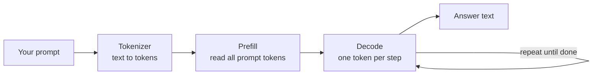
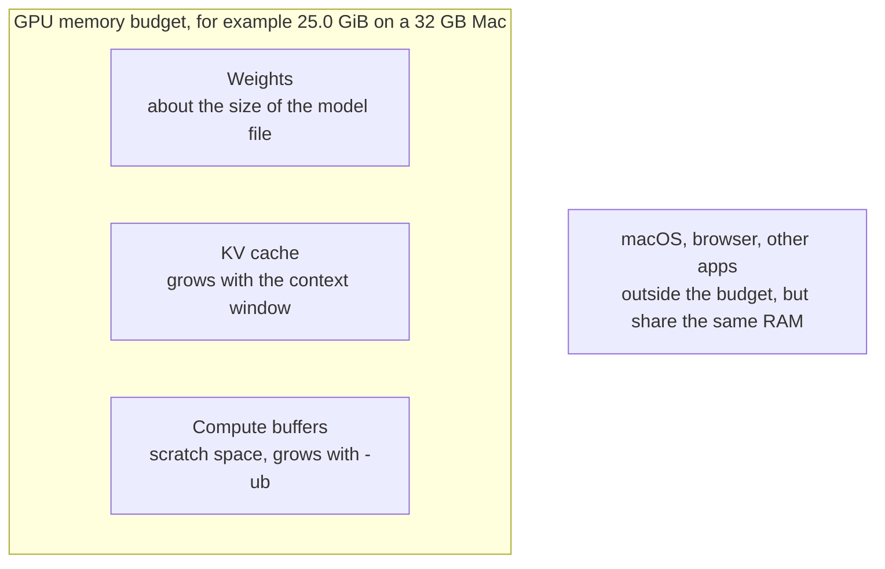

# Step 1: Understand

This page explains what happens when a model runs on your computer. You need these ideas to plan memory and read benchmark numbers. New words link to the [glossary](glossary.md).

[Back to the learning base](README.md) · Next: [Step 2: Plan](2-plan.md)

## What happens when you send a prompt

1. A **server** program receives your request. It is the [engine](glossary.md#engine-runtime), such as llama.cpp.
2. The engine splits your text into [tokens](glossary.md#token).
3. **Prefill:** the engine reads all prompt tokens and stores working data in the [KV cache](glossary.md#kv-cache).
4. **Decode:** the engine predicts one new token, adds it to the answer and repeats until the answer ends.
5. The server sends the tokens back as text.

## Where the memory goes

A running model needs memory for four things. The model file is only the first one.

| Part | What it is | What makes it bigger |
| --- | --- | --- |
| [Weights](glossary.md#model-and-weights) | The model's numbers | More parameters, more [bits per weight](glossary.md#bits-per-weight-bpw) |
| [KV cache](glossary.md#kv-cache) | Saved data for every token in the context | Longer context, more [attention](glossary.md#attention) layers, 16-bit ([f16](glossary.md#f16-and-q8_0-kv)) instead of 8-bit (q8_0) storage |
| [Compute buffers](glossary.md#compute-buffer) | Scratch memory for one step | Bigger [ubatch](glossary.md#batch-and-ubatch--b--ub) |
| Operating system and apps | Everything else on the computer | Open browser tabs, editors, other servers |

*Measured example* (units: [GB, GiB and MiB](glossary.md#gb-gib-and-mib)): Inkling 2 Mini at 128K context on an M1 Max used 16,332 MiB for weights, 2,282 MiB for the KV cache and 4,712 MiB for compute buffers: 23,326 MiB in total. See the [worked example](worked-example-m1-max-32gb.md#why-the-defaults-ran-out-of-memory).

## What limits speed

The two phases have different limits:

- **Prefill** does a lot of math on many tokens at once. More GPU cores make it faster.
- **Decode** must read every [active parameter](glossary.md#active-parameters) from memory for each new token. More memory bandwidth makes it faster.

So a model with fewer active parameters decodes faster on the same computer.

### Example: two models with the same file size but different speeds

Here are two models from the [worked example](worked-example-m1-max-32gb.md), both measured on the same 32 GB Mac:

- **LFM2.5-24B-A2B** is an [MoE model](glossary.md#dense-vs-moe) (Mixture of Experts). It has 24 billion parameters in total, but for each new token it uses only about 2.4 billion of them: the few "experts" its router picks.
- **Qwen3.8-27B** is a [dense model](glossary.md#dense-vs-moe). It has 27 billion parameters, and it uses all 27 billion for every new token.

| | LFM2.5-24B-A2B (MoE) | Qwen3.8-27B (dense) |
| --- | --- | --- |
| Model file size | 19.5 GB | 17.7 GB |
| Parameters used for each new token | about 2.4 billion | all 27 billion |
| Data read from memory for each new token | about 2 GB | about 16.5 GB |
| Decode speed (measured) | 68.9 tok/s | 11.9 tok/s, or about 15 tok/s with [speculative decoding](glossary.md#speculative-decoding) |

Both files are almost the same size, so both need about the same memory. But for every new token, Qwen must read about eight times more data than LFM. That is why LFM writes its answer about 4.5–6 times faster.

*Analogy:* both models own a library of the same size. The MoE model reads a few chosen books for each token. The dense model reads every book for each token.

You can estimate the best possible decode speed:

> decode ceiling (tok/s) ≈ memory bandwidth (GB/s) ÷ GB read per token

*Example:* the M1 Max has about 353 GB/s of memory bandwidth (measured). Qwen3.8-27B reads about 16.5 GB per token. 353 ÷ 16.5 ≈ 21 tok/s at best. Find your own chip's memory bandwidth in its specifications.

Real engines reach 25–60% of this ceiling in the worked examples. The ceiling tells you how much room is left for tuning.

## The engine must match the model

A model file works only with an engine that supports its **architecture** (how its layers are built) and its **format** (GGUF or MLX). A successful download does not prove that the file will run. Some new models need a special engine build for a few weeks.

*Measured example:* the official llama.cpp ([mainline](glossary.md#build-mainline-and-fork)) loaded the Inkling 2 Mini GGUF file but wrote gibberish. Unsloth's version of llama.cpp, [build](glossary.md#build-mainline-and-fork) `b12588-mix-c0c3de8`, gave correct output.

## Check your understanding

- Inkling 2 Mini is an MoE model with 26.4B parameters. It uses only 3.4B of them for each token. Why does it need memory for all 26.4B?
- Which phase gets faster with more GPU cores, and which gets faster with more memory bandwidth?
- Name the three parts of the GPU memory budget that the server log reports.

Answers: all experts must stay in memory because any token may need any expert. Prefill scales with cores; decode scales with bandwidth. Weights, KV cache and compute buffers.

Next: [Step 2: Plan](2-plan.md)
