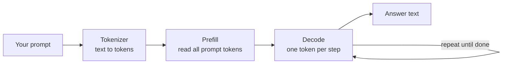
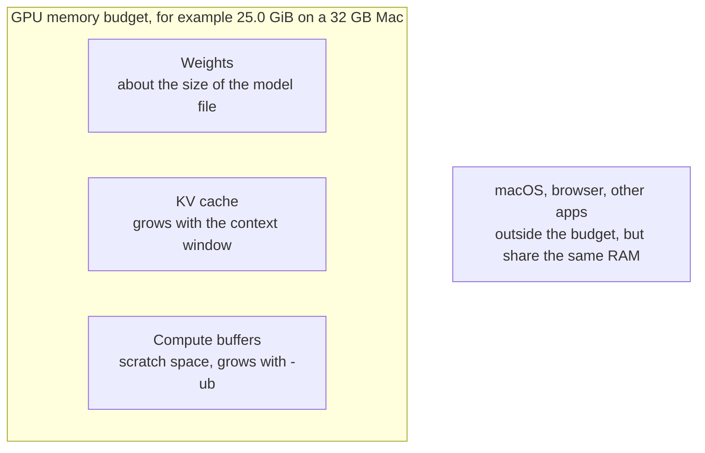

# Step 1: Understand

This page explains what happens when a model runs on your computer. You need these ideas to plan memory and read benchmark numbers. New words link to the [glossary](glossary.md).

[Back to the learning base](README.md) · Next: [Step 2: Plan](2-plan.md)

## What happens when you send a prompt

1. A **server** program receives your request. It is the [engine](glossary.md#engine-runtime), such as llama.cpp.
2. The engine splits your text into [tokens](glossary.md#token).
3. **Prefill:** the engine reads all prompt tokens and stores working data in the [KV cache](glossary.md#kv-cache).
4. **Decode:** the engine predicts one new token, adds it to the answer and repeats until the answer ends.
5. The server sends the tokens back as text.

## Where the memory goes

A running model needs memory for four things. The model file is only the first one.

| Part | What it is | What makes it bigger |
| --- | --- | --- |
| [Weights](glossary.md#model-and-weights) | The model's numbers | More parameters, more [bits per weight](glossary.md#bits-per-weight-bpw) |
| [KV cache](glossary.md#kv-cache) | Saved data for every token in the context | Longer context, more attention layers, f16 instead of [q8_0](glossary.md#q8_0-kv) |
| [Compute buffers](glossary.md#compute-buffer) | Scratch memory for one step | Bigger [ubatch](glossary.md#batch-and-ubatch--b--ub) |
| Operating system and apps | Everything else on the computer | Open browser tabs, editors, other servers |

*Measured example:* Inkling 2 Mini at 128K context on an M1 Max used 16,332 MiB for weights, 2,282 MiB for the KV cache and 4,712 MiB for compute buffers: 23,326 MiB in total. See the [worked example](worked-example-m1-max-32gb.md#why-the-defaults-ran-out-of-memory).

## What limits speed

The two phases have different limits:

- **Prefill** does a lot of math on many tokens at once. More GPU cores make it faster.
- **Decode** must read every [active parameter](glossary.md#active-parameters) from memory for each new token. More memory bandwidth makes it faster.

So a model with fewer active parameters decodes faster on the same computer. This is why an MoE model with 2.4B active parameters can be four times faster than a dense 27B model of similar file size.

*Measured example:* LFM2.5-24B-A2B reads about 2 GB per token and decodes at 68.9 tok/s on the M1 Max. Dense Qwen3.8-27B reads about 16.5 GB per token and decodes at about 15 tok/s with speculation.

You can estimate the best possible decode speed:

> decode ceiling (tok/s) ≈ memory bandwidth (GB/s) ÷ GB read per token

Real engines reach 25–60% of this ceiling in the worked examples. The ceiling tells you how much room is left for tuning.

## The engine must match the model

A model file works only with an engine that supports its **architecture** (how its layers are built) and its **format** (GGUF or MLX). A successful download does not prove that the file will run. Some new models need a special engine build for a few weeks.

*Measured example:* mainline llama.cpp loaded the Inkling 2 Mini GGUF but wrote gibberish. The Unsloth build `b12588-mix-c0c3de8` gave correct output.

## Check your understanding

- Why does a 26.4B MoE model need memory for 26.4B parameters when only 3.4B are active per token?
- Which phase gets faster with more GPU cores, and which gets faster with more memory bandwidth?
- Name the three parts of the GPU memory budget that the server log reports.

Answers: all experts must stay in memory because any token may need any expert. Prefill scales with cores; decode scales with bandwidth. Weights, KV cache and compute buffers.

Next: [Step 2: Plan](2-plan.md)
