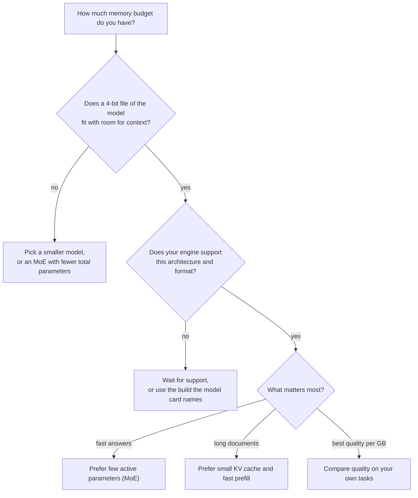

# Step 2: Plan

This page helps you choose a model and a quant that fit your computer before you download anything. Large files take a long time to download, so plan first.

[Back to the learning base](README.md) · Previous: [Step 1: Understand](1-understand.md) · Next: [Step 3: Run a model](3-run.md)

## 1. Find your memory budget

| Computer | Your budget |
| --- | --- |
| Apple silicon Mac (units: [GB, GiB and MiB](glossary.md#gb-gib-and-mib)) | The [Metal memory budget](glossary.md#metal-memory-budget), not the full RAM. On the tested 32 GB M1 Max it was 25.0 GiB (measured). You see your exact number in Step 3, when llama.cpp starts: it prints `recommendedMaxWorkingSetSize`. |
| PC with an NVIDIA or AMD GPU | The GPU card's own memory ([VRAM](glossary.md#unified-memory)), for full speed. Layers that do not fit run on the CPU and are much slower. |
| CPU only | System RAM minus the operating system and apps. Expect slow decode. |

Also count the apps you keep open. In the worked example, other desktop apps used about 14 GiB of the 32 GB the whole time.

## 2. Use the memory rule of thumb

Add the three GPU parts from [Step 1](1-understand.md#where-the-memory-goes):

> total ≈ weights + KV cache + compute buffers, and this total must fit inside your budget

Then estimate each part:

| Part | Estimate (all estimated, then check the server log) |
| --- | --- |
| Weights | Model file size. Or: parameters in billions × bits per weight ÷ 8 = GB. |
| KV cache | Depends on the model. Use the [formula](glossary.md#kv-cache), or start with a short context and read the log. Models with few [attention](glossary.md#attention) layers have small caches. |
| Compute buffers | Usually 0.5–1 GB. Some models need much more: Inkling 2 Mini needed 4.7 GB at `-ub 256`. |
| Safety margin | Keep at least 1–2 GB free inside the budget. |

**Quick rule for a first try (estimated):** pick a model file no larger than about **60% of your RAM** on a Mac, or about **80% of VRAM** on a GPU, and start with a short context, such as 4K–8K tokens. Increase the context only after it runs.

*Worked check for a 32 GB Mac:* a 17.6 GB file is 55% of 32 GB. The budget is 25.0 GiB, about 26.8 GB (see [GB, GiB and MiB](glossary.md#gb-gib-and-mib)). That leaves about 9 GB for the KV cache and compute buffers. Inkling 2 Mini at 128K needed about 7.3 GB for those with q8_0 KV, so it fit with a small margin. With the default 16-bit ([f16](glossary.md#f16-and-q8_0-kv)) KV cache it did not fit.

## 3. Choose a model

Answer these questions in order.

Points to remember:

- **Total parameters decide memory. Active parameters decide decode speed.** See [active parameters](glossary.md#active-parameters).
- **Read the model card.** It states the architecture, the context limit, the recommended sampling and the supported engines.
- **Check the engine first.** A new architecture may need a special build. Do not mix files and builds from different guides.

## 4. Choose a quant

A **quant** is a quantized copy of a model: the same model stored with fewer bits per weight. See [quantization](glossary.md#quantization). The name tells you the bits: Q8 is about 8 bits, Q4 about 4 bits.

| Quant level | Typical use (estimated guidance) |
| --- | --- |
| 8-bit (Q8_0, MLX 8-bit) | Close to the original. Use it when it fits with room for context. |
| 5–6-bit (Q5_K_M, Q6_K, MLX 6-bit) | Very close to 8-bit, smaller. |
| **4-bit ([Q4_K_M](glossary.md#q4_k_m), [UD-Q4_K_XL](glossary.md#ud-q4_k_xl), [MLX](glossary.md#mlx-format) 4-bit)** | **The usual starting point.** Good quality, half the size of 8-bit. |
| 3-bit and below | Use only when nothing larger fits. Quality loss becomes easier to notice. |

Prefer a quant with published quality data, such as [KL divergence](glossary.md#kl-divergence-kld) or top-token match. Then test it on your own prompts in [Step 4](4-measure.md).

*Measured example:* on a 32 GB Mac, `UD-Q4_K_XL` (17.63 GB) of Inkling 2 Mini left room for a 128K cache. The 8-bit `UD-Q8_K_XL` (22.9 GB) left no room inside the 25 GiB budget.

## 5. Check that the model is not far too large

Some models have small names but are very large. "Flash" or "Mini" does not mean small. Check the total parameters and the file sizes before you plan.

*Source-reported examples, checked 22 November 2026:*

| Model | Total parameters | Smallest GGUF file on [Hugging Face](glossary.md#hugging-face) | Fits a 32 GB Mac? |
| --- | --- | --- | --- |
| [GLM-5.3-Flash](https://huggingface.co/zai-org/GLM-5.3-Flash) | 320B, 18B active | about 93 GB ([`UD-IQ1_S`](https://huggingface.co/unsloth/GLM-5.3-Flash-GGUF)) | No |
| [DeepSeek V4.1 Flash](https://huggingface.co/deepseek-ai/DeepSeek-V4.1-Flash) | 552B in the main model; uses 8B per token for prefill and 16B for decode | about 233 GB ([`UD-IQ1_S`](https://huggingface.co/unsloth/DeepSeek-V4.1-Flash-1017-GGUF)) | No |
| Inkling 2 Mini | 26.4B, 3.4B active | `UD-Q4_K_XL` is 17.63 GB | Yes, tested |

`IQ1_S` is an extreme quant of about 1 bit per weight, the smallest that exists for these models. The file sizes are the sum of the files in each Hugging Face folder. GLM-5.3-Flash and DeepSeek V4.1 Flash were not run on the M1 Max. See the [worked example](worked-example-m1-max-32gb.md#models-that-do-not-fit-or-do-not-work-well-on-m1) for why.

## Planning checklist

- [ ] I know my memory budget, and how much my other apps use.
- [ ] The model file is no larger than about 60% of my RAM (Mac) or 80% of the GPU card's memory (VRAM).
- [ ] The model card names an engine and format I can use.
- [ ] I picked a quant with published quality data, or I will test it.
- [ ] I will start with a short context and one request slot.

Next: [Step 3: Run a model](3-run.md)
