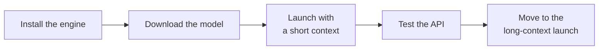

# Step 3: Do

This page takes you from nothing to a working local server. It uses Inkling 2 Mini with llama.cpp on an Apple silicon Mac, the setup from the [worked example](worked-example-m1-max-32gb.md). An MLX path for LFM2.5-24B-A2B follows.

[Back to the learning base](README.md) · Previous: [Step 2: Plan](2-plan.md) · Next: [Step 4: Measure](4-measure.md)

> **Not tested for this page.** These commands follow the author's reports and the linked tool documentation. They were not run while this page was written. Check the linked sources if a command fails.



## Before you start

You need:

- A terminal, Git, Python 3.10 or newer and [tmux](https://github.com/tmux/tmux/wiki). tmux keeps the server running after you close the terminal window.
- About 20 GB of free disk space for one model.
- The memory plan from [Step 2](2-plan.md).

Make a working folder:

```bash
git clone https://github.com/jellydn/tiny-local-ai.git
cd tiny-local-ai
python3 -m venv .venv
source .venv/bin/activate
python -m pip install huggingface_hub
mkdir -p models runtime
```

The repository's `.gitignore` keeps `models/` and `runtime/` out of Git.

## 1. Install the engine

Inkling 2 Mini needs Unsloth's llama.cpp build [`b12588-mix-c0c3de8`](https://github.com/unslothai/llama.cpp/releases/tag/b12588-mix-c0c3de8). When checked, mainline llama.cpp gave wrong output on these files. See [why that build](worked-example-m1-max-32gb.md#why-that-build).

On an Apple silicon Mac, download the `macos-arm64` archive and unpack it:

```bash
curl -L -o runtime/llama-mac.tar.gz \
  https://github.com/unslothai/llama.cpp/releases/download/b12588-mix-c0c3de8/llama-b12588-mix-c0c3de8-bin-macos-arm64.tar.gz
tar -xzf runtime/llama-mac.tar.gz -C runtime
find runtime -name llama-server
```

The last command prints the path of `llama-server`. Use that path below. The examples assume `runtime/llama-b12588-mix-c0c3de8/llama-server`. Keep the libraries in the same folder as the program.

For Linux or Windows, pick the archive for your GPU from the same release page: CUDA for NVIDIA, ROCm or Vulkan for AMD, or CPU.

## 2. Download the model

Download one file, not the whole repository:

```bash
hf download unsloth/Inkling-2-Mini-GGUF \
  Inkling-2-Mini-UD-Q4_K_XL.gguf \
  --local-dir models/inkling-2-mini
```

The file is about 17.63 GB. To repeat a test exactly, add `--revision` with the full commit hash that [sybil-solutions/local-ai-registry PR #466](https://github.com/sybil-solutions/local-ai-registry/pull/466) pins (it starts with `ae9327c5`), and compare the file's sha256 with the value on Hugging Face:

```bash
shasum -a 256 models/inkling-2-mini/Inkling-2-Mini-UD-Q4_K_XL.gguf
```

## 3. Launch with a short context

Start small. A 4K context needs little KV cache, so the first launch fits easily. Run the server in tmux:

```bash
SESSION="$(basename "$PWD")"
tmux new-session -d -s "$SESSION" 2>/dev/null || true
tmux send-keys -t "$SESSION" './runtime/llama-b12588-mix-c0c3de8/llama-server -m models/inkling-2-mini/Inkling-2-Mini-UD-Q4_K_XL.gguf -c 4096 -np 1 -ngl 99 --temp 1.0 --top-p 1.0 --top-k 0 --min-p 0.0 --jinja --alias inkling-2-mini --host 127.0.0.1 --port 8080' Enter
sleep 30
tmux capture-pane -p -t "$SESSION" -S -40
```

Wait until the log says the server is listening. Loading a 17 GB file can take a minute. Then open the chat page at `http://127.0.0.1:8080` in your browser.

To stop the server: `tmux attach -t "$SESSION"`, then press Ctrl-C.

### What the flags mean

| Flag | Meaning |
| --- | --- |
| `-m FILE` | The model file. |
| `-c 4096` | Context window in tokens. |
| `-np 1` | One request slot. Each extra slot needs more memory. |
| `-ngl 99` | Put up to 99 layers on the GPU, which means all layers here. |
| `--temp 1.0 --top-p 1.0 --top-k 0 --min-p 0.0` | Thinking Machines' recommended [sampling](glossary.md#sampling-settings) for this model. |
| `--jinja` | Use the chat template stored in the model file. Needed for correct chat format and tool calls. |
| `--alias NAME` | The model name that the API reports. |
| `--host 127.0.0.1` | Accept connections from this computer only. |

## 4. Test the API

In a second terminal:

```bash
curl http://127.0.0.1:8080/health
curl http://127.0.0.1:8080/v1/models
curl http://127.0.0.1:8080/v1/chat/completions \
  -H 'Content-Type: application/json' \
  -d '{"model":"inkling-2-mini","messages":[{"role":"user","content":"What is 17 times 23? Answer with the number."}],"max_tokens":1024}'
```

Check three things:

1. `/v1/models` lists `inkling-2-mini`.
2. The answer contains `391`.
3. The answer is readable text, not random characters. Random characters usually mean the engine and the file do not match.

Any tool that supports the OpenAI API can now use `http://127.0.0.1:8080/v1` as its base URL. See [OpenAI-compatible server](glossary.md#openai-compatible-server).

## 5. Move to the long-context launch

When the short launch works, stop it and try the launch from the worked example. It uses 128K tokens of context:

```bash
./runtime/llama-b12588-mix-c0c3de8/llama-server \
  -m models/inkling-2-mini/Inkling-2-Mini-UD-Q4_K_XL.gguf \
  -c 131072 -np 1 -ngl 99 -fa on --fit off \
  -ub 256 -ctk q8_0 -ctv q8_0 --cache-ram 0 \
  --temp 1.0 --top-p 1.0 --top-k 0 --min-p 0.0 \
  --jinja --alias inkling-2-mini --host 127.0.0.1 --port 8080
```

The new flags:

| Flag | Meaning | Why it is here |
| --- | --- | --- |
| `-c 131072` | 128K tokens of context. | The goal of the recipe. |
| `-fa on` | Flash attention: a faster, memory-saving way to compute attention. | Required for a quantized V cache. |
| `--fit off` | Do not let llama.cpp change unset settings on its own to fit memory. | Keeps the launch exactly as written, so results are repeatable. |
| `-ub 256` | [Micro-batch](glossary.md#batch-and-ubatch--b--ub) of 256 tokens instead of 512. | Makes the compute buffer about 1.4 GB smaller. |
| `-ctk q8_0 -ctv q8_0` | Store keys and values in 8 bits. See [q8_0 KV](glossary.md#q8_0-kv). | Makes the KV cache about half the size. |
| `--cache-ram 0` | Turn off the extra prompt cache in system RAM. | Saves RAM on a machine that is already full. |

Without `-ub 256` and q8_0 KV, this launch ran out of memory on the 32 GB M1 Max. See [why the defaults ran out of memory](worked-example-m1-max-32gb.md#why-the-defaults-ran-out-of-memory).

## Another path: an MLX model with mlx-lm

MLX models run only on Apple silicon. This example serves LFM2.5-24B-A2B, the fastest model in the worked example.

```bash
python3 -m venv .venv-mlx
.venv-mlx/bin/pip install mlx-lm==0.32.2 mlx==0.32.4
.venv-mlx/bin/hf download LiquidAI/LFM2.5-24B-A2B-MLX-6bit \
  --local-dir models/LFM2.5-24B-A2B-MLX-6bit
.venv-mlx/bin/mlx_lm.server --model models/LFM2.5-24B-A2B-MLX-6bit \
  --max-tokens 131072 --decode-concurrency 1 --prompt-concurrency 1 \
  --prompt-cache-size 1 --host 127.0.0.1 --port 8080
```

Run the last command in tmux, as above. Three things to know about `mlx_lm.server`:

- It stops answers at 512 tokens by default. A thinking model can stop in the middle of its thinking, so set `--max-tokens`.
- `/v1/models` can list every MLX model in your Hugging Face cache. Send the exact model path in the `model` field.
- Send the model card's sampling in each request: for this model, temperature 0.1, top-k 50 and repetition penalty 1.05.

The tested recipe used a small launcher from the registry that fixes the last two points: [`registry/launches/mlx-lm-lfm2.5-serve.py`](https://github.com/sybil-solutions/local-ai-registry/pull/475). See [Discussion #5](https://github.com/jellydn/tiny-local-ai/discussions/5) for the exact commands.

## If something goes wrong

See [FAQ and troubleshooting](faq.md#troubleshooting).

Next: [Step 4: Measure](4-measure.md)
