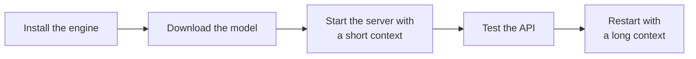

# Step 3b: Run a model in the terminal

This page takes you from nothing to a working local **server**: a program on your computer that waits for questions and sends back the model's answers. It uses Inkling 2 Mini with llama.cpp on an Apple silicon Mac, the setup from the [worked example](worked-example-m1-max-32gb.md). An MLX path for LFM2.5-24B-A2B follows.

Want to start without the terminal? Use [Step 3a: Unsloth Desktop](3a-unsloth-desktop.md) first, then come back here for full control over memory settings.

[Back to the learning base](README.md) · Previous: [Step 3a: No-terminal start](3a-unsloth-desktop.md) · Next: [Step 4: Measure](4-measure.md)

> **Not tested for this page.** These commands follow the author's reports and the linked tool documentation. They were not run while this page was written. Check the linked sources if a command fails.



## Before you start

You need:

- A terminal and Git.
- Python 3.10 or newer.
- [tmux](https://github.com/tmux/tmux/wiki). tmux is a terminal program that keeps a command running after you close the terminal window. On a Mac, install it with [Homebrew](https://brew.sh/): `brew install tmux`.
- About 20 GB of free disk space for one model.
- The memory plan from [Step 2](2-plan.md).

### Two words you will meet on this page

- **Hugging Face** ([huggingface.co](https://huggingface.co)) is a website that stores model files. A name such as `unsloth/Inkling-2-Mini-GGUF` is one folder (a "repository") there. `unsloth` is the owner and `Inkling-2-Mini-GGUF` is the folder.
- **Unsloth** is a company that makes smaller, quantized copies of models (called **quants**; see [quantization](glossary.md#quantization)) and shares them on Hugging Face. It also publishes its own version of llama.cpp.

### Make a working folder

```bash
git clone https://github.com/jellydn/tiny-local-ai.git
cd tiny-local-ai
python3 -m venv .venv
source .venv/bin/activate
python -m pip install huggingface_hub
mkdir -p models runtime
```

What these lines do:

- `python3 -m venv .venv` makes a **venv** (virtual environment): a private folder for Python packages, apart from the system Python.
- `source .venv/bin/activate` turns the venv on in this terminal. **Run this line again in each new terminal** before you use `hf`.
- `pip install huggingface_hub` installs the `hf` command, which downloads files from Hugging Face.
- The repository's `.gitignore` keeps `models/` and `runtime/` out of Git.

## 1. Install the engine

The [engine](glossary.md#engine-runtime) is the program that runs the model. Here it is `llama-server` from llama.cpp.

Inkling 2 Mini needs Unsloth's llama.cpp **build** [`b12588-mix-c0c3de8`](https://github.com/unslothai/llama.cpp/releases/tag/b12588-mix-c0c3de8). A build is one ready-to-run version of the program, named by a number. When checked, the official llama.cpp from ggml-org (called "mainline") gave wrong output on these files. See [why that build](worked-example-m1-max-32gb.md#why-that-build).

On an Apple silicon Mac (M1 or newer), download the `macos-arm64` file and unpack it:

```bash
curl -L -o runtime/llama-mac.tar.gz \
  https://github.com/unslothai/llama.cpp/releases/download/b12588-mix-c0c3de8/llama-b12588-mix-c0c3de8-bin-macos-arm64.tar.gz
tar -xzf runtime/llama-mac.tar.gz -C runtime
find runtime -name llama-server
```

The last command prints where `llama-server` is. The examples below use `runtime/llama-b12588-mix-c0c3de8/llama-server`. If `find` prints a different path, use that path in every command below. The folder also holds library files that `llama-server` needs; do not move the program out of its folder.

On Linux or Windows, pick the file for your GPU from the same release page. The file name tells you the GPU system: **CUDA** is for NVIDIA cards, **ROCm** and **Vulkan** work with AMD cards, and **cpu** needs no GPU.

## 2. Download the model

Download one file, not the whole Hugging Face repository. Run this in the terminal where the venv is on:

```bash
hf download unsloth/Inkling-2-Mini-GGUF \
  Inkling-2-Mini-UD-Q4_K_XL.gguf \
  --local-dir models/inkling-2-mini
```

The file is about 17.63 GB.

**Optional: get exactly the tested file.** Model files can change over time. To get the exact file from the worked example, add `--revision <hash>` to the command. The full hash is in [sybil-solutions/local-ai-registry PR #466](https://github.com/sybil-solutions/local-ai-registry/pull/466) and starts with `ae9327c5`. Then check that the download is complete and correct: open the file's page on Hugging Face, which shows its SHA256 [checksum](glossary.md#revision-and-checksum-sha256), and compare it with the output of:

```bash
shasum -a 256 models/inkling-2-mini/Inkling-2-Mini-UD-Q4_K_XL.gguf
```

## 3. Start the server with a short context

Start small. A 4K-token context needs little [KV cache](glossary.md#kv-cache) memory, so the first start fits easily.

Open a tmux session. This opens a new terminal screen inside tmux:

```bash
tmux new -s tiny-local-ai
```

Inside tmux, paste this command and press Enter:

```bash
./runtime/llama-b12588-mix-c0c3de8/llama-server \
  -m models/inkling-2-mini/Inkling-2-Mini-UD-Q4_K_XL.gguf \
  -c 4096 -np 1 -ngl 99 \
  --temp 1.0 --top-p 1.0 --top-k 0 --min-p 0.0 \
  --jinja --alias inkling-2-mini --host 127.0.0.1 --port 8080
```

The server prints a long log while it loads. Loading a 17 GB file can take a minute or more. It is ready when you see a line that contains `listening on http://127.0.0.1:8080`. Then open the chat page at `http://127.0.0.1:8080` in your browser.

How to use tmux:

| To do this | Press or type |
| --- | --- |
| Leave tmux and keep the server running | Press Ctrl-b, release, then press d |
| Go back to the server screen | `tmux attach -t tiny-local-ai` |
| Stop the server | Go back to the server screen and press Ctrl-C |
| Close the tmux session | After you stop the server, type `exit` |

### What the flags mean

| Flag | Meaning |
| --- | --- |
| `-m FILE` | The model file. |
| `-c 4096` | [Context window](glossary.md#context-window): at most 4,096 tokens for prompt and answer together. |
| `-np 1` | One request [slot](glossary.md#slots-and-parallel-requests--np): the server answers one request at a time. Each extra slot needs more memory. |
| `-ngl 99` | Put up to 99 [layers](glossary.md#layer) on the GPU. This model has fewer, so all layers go on the GPU. |
| `--temp 1.0 --top-p 1.0 --top-k 0 --min-p 0.0` | The [sampling](glossary.md#sampling-settings) that Thinking Machines, the maker of Inkling 2 Mini, recommends. |
| `--jinja` | Use the **chat template** stored in the model file. The chat template is the exact text format the model expects for user and assistant messages. It is also needed for **tool calls**, where the model asks a program to run a function. |
| `--alias NAME` | The model name that the API reports. |
| `--host 127.0.0.1` | Accept connections from this computer only. |

## 4. Test the API

The server has an API: a web address that programs can send requests to. Open a **second terminal** (not inside tmux) and run:

```bash
curl http://127.0.0.1:8080/health
curl http://127.0.0.1:8080/v1/models
curl http://127.0.0.1:8080/v1/chat/completions \
  -H 'Content-Type: application/json' \
  -d '{"model":"inkling-2-mini","messages":[{"role":"user","content":"What is 17 times 23? Answer with the number."}],"max_tokens":1024}'
```

The question needs a short answer, but `max_tokens` is 1024. Inkling 2 Mini is a **thinking model**: it first writes its reasoning as tokens, then the answer. The reasoning also counts toward `max_tokens`.

Check three things:

1. `/v1/models` lists `inkling-2-mini`.
2. The answer contains `391`.
3. The answer is readable text, not random characters. Random characters usually mean the engine and the file do not match.

Any tool that supports the OpenAI API can now use `http://127.0.0.1:8080/v1` as its base URL. See [OpenAI-compatible server](glossary.md#openai-compatible-server).

## 5. Move to the long-context start

When the short start works, stop the server (Ctrl-C in tmux) and start it again with this command. It uses 128K tokens (131,072) of context, the setup from the worked example:

```bash
./runtime/llama-b12588-mix-c0c3de8/llama-server \
  -m models/inkling-2-mini/Inkling-2-Mini-UD-Q4_K_XL.gguf \
  -c 131072 -np 1 -ngl 99 -fa on --fit off \
  -ub 256 -ctk q8_0 -ctv q8_0 --cache-ram 0 \
  --temp 1.0 --top-p 1.0 --top-k 0 --min-p 0.0 \
  --jinja --alias inkling-2-mini --host 127.0.0.1 --port 8080
```

The new flags:

| Flag | Meaning | Why it is here |
| --- | --- | --- |
| `-c 131072` | 128K tokens of context. | The goal of this setup. |
| `-fa on` | Flash attention: a faster way to do the [attention](glossary.md#attention) math that also uses less memory. | llama.cpp needs it to store the V (value) part of the KV cache in 8 bits. |
| `--fit off` | Do not let llama.cpp change unset settings on its own to fit memory. | Keeps the start exactly as written, so results are repeatable. |
| `-ub 256` | [Micro-batch](glossary.md#batch-and-ubatch--b--ub) of 256 tokens instead of the default 512. | Makes the scratch memory (compute buffer) about 1.4 GB smaller. |
| `-ctk q8_0 -ctv q8_0` | Store keys and values in 8 bits instead of the default 16 bits (f16). See [q8_0 KV](glossary.md#f16-and-q8_0-kv). | Makes the KV cache about half the size. |
| `--cache-ram 0` | Turn off the extra prompt cache in system RAM. | Saves RAM on a machine that is already full. |

Without `-ub 256` and q8_0 KV, this start ran out of memory on the 32 GB M1 Max. See [why the defaults ran out of memory](worked-example-m1-max-32gb.md#why-the-defaults-ran-out-of-memory).

## Another path: an MLX model with mlx-lm

[MLX](glossary.md#mlx-format) models run only on Apple silicon Macs. This example serves LFM2.5-24B-A2B, the fastest model in the worked example, with [mlx-lm](glossary.md#mlx-lm). It uses a second venv, so the two setups do not mix:

```bash
python3 -m venv .venv-mlx
.venv-mlx/bin/pip install mlx-lm==0.32.2 mlx==0.32.4
.venv-mlx/bin/hf download LiquidAI/LFM2.5-24B-A2B-MLX-6bit \
  --local-dir models/LFM2.5-24B-A2B-MLX-6bit
```

Then start the server inside tmux. Both servers use port 8080, so only one can run at a time:

1. If the llama.cpp server still runs, stop it: `tmux attach -t tiny-local-ai`, then press Ctrl-C.
2. If the tmux session is still open, use it (`tmux attach -t tiny-local-ai`). Otherwise open a new one with `tmux new -s tiny-local-ai`.
3. Paste this command and press Enter:

```bash
.venv-mlx/bin/mlx_lm.server --model models/LFM2.5-24B-A2B-MLX-6bit \
  --max-tokens 131072 --decode-concurrency 1 --prompt-concurrency 1 \
  --prompt-cache-size 1 --host 127.0.0.1 --port 8080
```

| Flag | Meaning |
| --- | --- |
| `--max-tokens 131072` | The longest answer allowed. The default is 512 tokens, which can stop a thinking model in the middle of its reasoning. |
| `--decode-concurrency 1` | Write the answer for one request at a time. The default is 32. |
| `--prompt-concurrency 1` | Read one prompt at a time. The default is 8. |
| `--prompt-cache-size 1` | Keep the cache for one past prompt. The default is 10. Fewer caches use less memory. |

Two more things to know about `mlx_lm.server`:

- `/v1/models` can list every MLX model you downloaded to the Hugging Face cache (`~/.cache/huggingface`). Send the exact model path in the `model` field.
- Send the model card's sampling in each request. For this model: temperature 0.1, top-k 50 and repetition penalty 1.05. **Repetition penalty** makes the model less likely to repeat the same words.

A test request:

```bash
curl http://127.0.0.1:8080/v1/chat/completions \
  -H 'Content-Type: application/json' \
  -d '{"model":"models/LFM2.5-24B-A2B-MLX-6bit","messages":[{"role":"user","content":"What is 17 times 23? Answer with the number."}],"max_tokens":4096,"temperature":0.1,"top_k":50,"repetition_penalty":1.05}'
```

The tested setup used a small launcher script from the registry that lists only the served model and adds the sampling for you: [`registry/launches/mlx-lm-lfm2.5-serve.py`](https://github.com/sybil-solutions/local-ai-registry/pull/475). See [Discussion #5](https://github.com/jellydn/tiny-local-ai/discussions/5) for the exact commands.

## If something goes wrong

See [FAQ and troubleshooting](faq.md#troubleshooting).

Next: [Step 4: Measure](4-measure.md)
