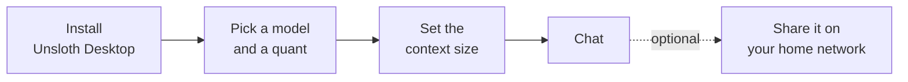

# Step 3a: No-terminal start with Unsloth Desktop

This is the easiest way to run your first model. You install an app, pick a model from a list and start chatting. You do not type any commands. When you want full control over memory settings, go on to [Step 3b: Run a model in the terminal](3-run.md).

[Back to the learning base](README.md) · Previous: [Step 2: Plan](2-plan.md) · Next: [Step 3b: Run a model in the terminal](3-run.md)

> **Not tested for this page.** These steps follow the [Unsloth Desktop documentation](https://unsloth.ai/docs/desktop) and the GPU Partner guide below, checked 23 November 2026. The author's measured results on this site come from the terminal path, not from this app. App menus can change between versions.

**Credit:** this page is based on Jerry James, [A beginner's guide to Local AI with Inkling, Qwen, and Unsloth](https://www.gpupartner.com/blog/beginners-guide-local-ai-inkling-qwen-unsloth) (GPU Partner, 22 November 2026). That guide used Windows and an NVIDIA RTX 5090 with 32 GB of [VRAM](glossary.md#unified-memory). Read it for screenshots of each step.

## What Unsloth Desktop is

[Unsloth Desktop](glossary.md#unsloth-desktop) is a free, open-source app for macOS, Windows and Linux. It downloads models from [Hugging Face](glossary.md#hugging-face), runs them and shows a chat window. Inside, it uses llama.cpp for [GGUF](glossary.md#gguf) files, and it can also run [MLX](glossary.md#mlx-format) models on a Mac. Unsloth is the same company that makes the `UD-Q4_K_XL` files used everywhere on this site.

You still need the plan from [Step 2](2-plan.md): the app cannot make a model fit if it is too large for your memory.

## 1. Install the app

1. Open the [Unsloth download page](https://unsloth.ai/download) and download the file for your system.
2. Install it:
   - **macOS:** open the `.dmg` file and drag Unsloth to **Applications**. ([Mac install guide](https://unsloth.ai/docs/get-started/install/mac))
   - **Windows** and **Linux:** run the installer. ([Windows guide](https://unsloth.ai/docs/get-started/install/windows-installation), [Linux guide](https://unsloth.ai/docs/get-started/install/linux))
3. Launch the app. The first start can take a few minutes while it finishes the installation.

**If you already have the app, update it first.** Inkling 2 Mini is new and needs a recent engine build. An old version can fail to load it or write wrong text. See [the engine must match the model](1-understand.md#the-engine-must-match-the-model).

## 2. Pick a model and a quant

1. Open the **Select model** drop-down at the top of the chat window. (You can also use the **Model hub** tab.)
2. Search for the model, for example **Inkling 2 Mini**. Pick the repository `unsloth/Inkling-2-Mini-GGUF`.
3. The app shows a list of [quants](glossary.md#quantization) with their download sizes. Pick **`UD-Q4_K_XL`** (17.63 GB). It is Unsloth's recommended file for this model, and it is the file used in the [worked example](worked-example-m1-max-32gb.md).
4. Wait for the download to finish. Then select the model in the chat window.

If 17.63 GB is too large for your computer, use the [memory size table](2-plan.md#which-model-for-your-memory-size) to pick a smaller quant or a smaller model.

The `M` and `S` versions of a quant (for example `UD-Q4_K_M`) are a little smaller than `XL`. For Inkling 2 Mini, Unsloth reports almost the same quality for `UD-Q4_K_M` (16.61 GB) and `UD-Q4_K_XL` (source-reported, see [Step 2](2-plan.md#4-choose-a-quant)).

## 3. Set the context size

The [context window](glossary.md#context-window) is how many tokens the model can see at once. A bigger window uses more memory for the [KV cache](glossary.md#kv-cache), even when you do not fill it.

1. After the download, a gear icon appears next to the model. Click it.
2. Set the context size. **Auto** lets the app choose. If you set it yourself, start small, for example 8K–16K tokens, and raise it later.
3. Load the model and send a test question, such as "What is 17 times 23?". The answer must contain `391`, in readable text.

**On a 32 GB Mac, 128K is hard.** The worked example reached 128K tokens with Inkling 2 Mini only with two memory settings: a micro-batch of 256 (`-ub 256`) and an 8-bit [q8_0 KV cache](glossary.md#f16-and-q8_0-kv). With the default settings it ran out of memory. If the app's settings do not show these options, keep the context shorter, or use the [terminal path](3-run.md#5-move-to-the-long-context-start). See the [Mac notes](worked-example-m1-max-32gb.md#mac-notes).

## 4. Optional: share it on your home network

**LAN access** lets other devices on the same Wi-Fi or wired network, such as a phone or a laptop, open your model in their web browser. Nothing goes to the internet. See [LAN access](glossary.md#lan-access).

1. Open **Settings** (the gear icon at the bottom left) and go to **Remote & LAN**. Unsloth's docs list it as Settings → API → Remote & LAN.
2. Set a **Remote password**. The LAN options stay grey until you set one.
3. On the **LAN access** card, press **Start**. Wait until the status says **Online**.
4. The card shows an address, such as `http://192.168.1.42:8888`. Open it on another device on the same network.
5. Sign in with the user name **`unsloth`** and your Remote password.

Things to know:

- The computer must stay on, with Unsloth running, for others to use it.
- **The connection is not encrypted.** It is plain HTTP. Use LAN access only on a network you trust, such as your home network, not on public Wi-Fi.
- **Tools run on your computer.** The app's tools, such as web search, Python and the terminal, run as your user account. Anyone who can sign in can use them. Read the security notes on [Unsloth's LAN page](https://unsloth.ai/docs/desktop/lan) before you share the address.
- The address can change when your router gives the computer a new IP address. Unsloth's LAN page explains how to keep it the same.

## When to move to the terminal path

The app is enough for chat. Use [Step 3b](3-run.md) when you want to:

- choose the exact engine build and model file, and record them;
- set memory options such as `-ub` and the KV cache type yourself, to reach a long context;
- read the server log, which shows the memory each part uses (needed for [Step 4: Measure](4-measure.md) and [Step 5: Optimise](5-optimise.md)).

Next: [Step 3b: Run a model in the terminal](3-run.md)
