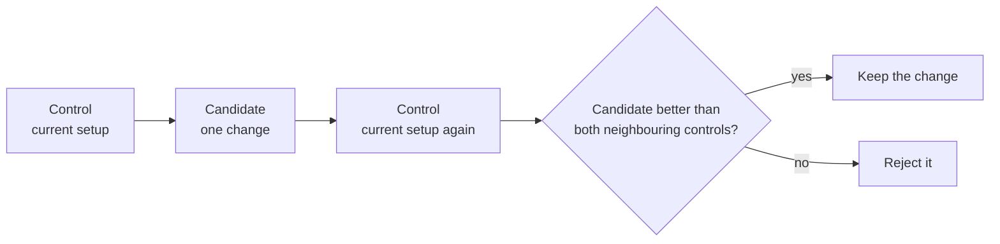

# Step 4: Measure

A model that loads is not yet a model that works well. This page shows how to measure speed, memory and quality, and how to compare two setups fairly.

[Back to the learning base](README.md) · Previous: [Step 3b: Run a model in the terminal](3-run.md) · Next: [Step 5: Optimise](5-optimise.md)

## What to measure

| Question | Measure | Unit |
| --- | --- | --- |
| How fast does the answer appear? | [Decode](glossary.md#prefill-vs-decode) speed | tok/s |
| How fast does it read long input? | [Prefill](glossary.md#prefill-vs-decode) speed | tok/s |
| How long do I wait for the first word? | [Time to first token](glossary.md#time-to-first-token-ttft) | seconds |
| Does it fit, with room to spare? | GPU buffers, peak memory, swap | MiB or GiB (see [units](glossary.md#gb-gib-and-mib)) |
| Are the answers right? | Checkable test prompts | number correct |
| Can it use long input? | [Needle recall](glossary.md#needle-recall) at a long prompt length | pass or fail |

Measure prefill and decode separately. One "tok/s" number without a phase is not useful.

## Read the memory from the server log

When llama.cpp starts, it prints one line for each buffer it allocates. Search the log for `buffer size`. Add the lines that name the GPU and skip the lines that name the CPU. On a Mac the GPU lines say **Metal** (Apple's GPU system); on an NVIDIA card they say **CUDA**.

If the server runs in the tmux session from [Step 3b](3-run.md#3-start-the-server-with-a-short-context), this prints those lines:

```bash
tmux capture-pane -p -t tiny-local-ai -S -400 | grep -E 'recommendedMaxWorkingSetSize|buffer size'
```

You get the budget, then the weights, KV cache and compute buffers. Their sum must stay below the budget. On a Mac, also watch **Memory Pressure** and **Swap Used** in Activity Monitor while a long request runs. Swap that keeps growing means the setup is too large.

## Read the speed from the API

`llama-server` adds a `timings` object to each chat response. It contains `prompt_per_second` (prefill) and `predicted_per_second` (decode). With [jq](https://jqlang.org/):

```bash
curl -s http://127.0.0.1:8080/v1/chat/completions \
  -H 'Content-Type: application/json' \
  -d '{"model":"inkling-2-mini","messages":[{"role":"user","content":"Write a 300-word story about a lighthouse."}],"max_tokens":512}' \
  | jq '.timings | {prompt_n, prompt_per_second, predicted_n, predicted_per_second}'
```

Other servers may not report timings. You can measure them yourself from the program that sends the request:

- **TTFT:** add `"stream": true` to the request. The server then sends the answer token by token. Note the time when the first token arrives. A short script can do this for you.
- **Prefill:** prompt tokens ÷ TTFT.
- **Decode:** (answer tokens − 1) ÷ time from the first to the last token.

The worked examples used these formulas.

## Compare two setups fairly

Speed changes from run to run. A laptop also gets slower over a long session: in the Qwen3.8-27B test from the worked example, [control runs](glossary.md#control-run) drifted down about 9% over 70 minutes. Use this method:



Rules:

1. **Change one thing at a time.**
2. **Run each setup several times** and use the median. The worked examples used the median of 6 runs of 512 tokens.
3. **Keep prompts and sampling the same** inside one comparison.
4. **Add a unique prefix to each prompt** when you measure prefill. Otherwise the server can reuse its cache, and prefill looks too fast.
5. **Close other model servers.** Run only one at a time.
6. **Use the same power state.** On a laptop, stay on AC power.

## Check quality with tests, not impressions

A fast model that gives wrong answers is not useful. Use prompts whose answers a script can check:

- A coding task that you run against hidden tests.
- A SQL query that you run in SQLite.
- A math or logic question with one correct answer, such as "How many numbers from 1 to 1000 are divisible by 3 or 5 but not by 15?" (401).
- A needle test: hide a 5-digit code in a long document and ask for it.

Keep 20–50 prompts from your real work. Run them on each model or quant with the model's recommended sampling. Count correct answers, answer length and total time.

*Measured example:* Inkling 2 Mini and LFM2.5-24B-A2B both scored 6/6 on six checkable prompts. LFM wrote 2.8 times more tokens but finished 16% sooner, because it decodes about 3.4 times faster. See [Discussion #5](https://github.com/jellydn/tiny-local-ai/discussions/5).

To compare quants without your own tests, use the [KL divergence](glossary.md#kl-divergence-kld) and top-token match that the quant maker (for example Unsloth) publishes. Lower KLD and a higher match mean the quant is closer to the original.

## Record every result

Save this for each run so you or others can repeat it:

- Model ID, [revision](glossary.md#revision-and-checksum-sha256) and quant file name, plus the file's [sha256 checksum](glossary.md#revision-and-checksum-sha256).
- Engine name and exact build or version.
- The full launch command.
- Computer, chip, GPU cores, RAM, OS version and power state.
- Prompts, sampling settings and answer length.
- Results, each labelled as **measured**, **source-reported** or **estimated**.

Next: [Step 5: Optimise](5-optimise.md)
