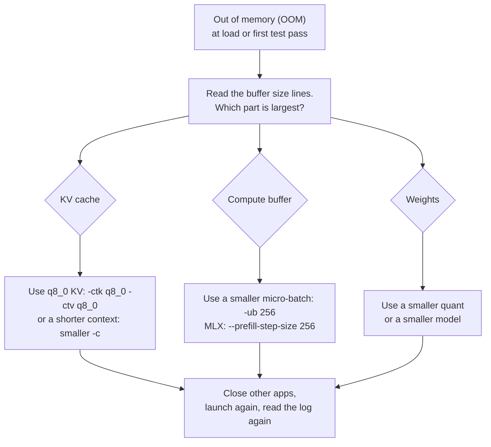

# Step 5: Optimise

Optimising means changing one setting, measuring again and keeping only real gains. This page lists the settings to try, in order, and what the worked examples found.

[Back to the learning base](README.md) · Previous: [Step 4: Measure](4-measure.md) · Next (optional): [Step 6: Fine-tune](6-fine-tune.md)

## Work in this order

1. **Make it fit.** A setup that runs out of memory has no speed.
2. **Find the ceiling.** Know how much faster it could possibly get.
3. **Try one change at a time.** Measure each with the [control–candidate–control](4-measure.md#compare-two-setups-fairly) method.
4. **Stop at the [plateau](glossary.md#plateau).** When no change beats the controls, the setup is done. That is a useful result too.

## 1. Make it fit

If the server stops with an out-of-memory error, read the `buffer size` lines in the log first. Then fix the largest part.

Other ways to make it fit:

- **One slot** (`-np 1`). Each slot needs memory.
- **Close other apps.** On a Mac they share the same RAM.
- **Text only.** Image input needs an extra [projector](glossary.md#projector-mmproj) file and more memory.

*Measured example:* Inkling 2 Mini at 128K on a 32 GB Mac. The KV cache change and the ubatch change were both needed. See [why the defaults ran out of memory](worked-example-m1-max-32gb.md#why-the-defaults-ran-out-of-memory).

On a Mac, you can raise the GPU memory limit with `sudo sysctl iogpu.wired_limit_mb=…`. The worked examples did **not** do this. It leaves less memory for macOS and can make the system unstable. Try the changes above first.

## 2. Find the ceiling

Estimate the best possible speeds for your computer:

- **Decode ceiling** ≈ memory bandwidth ÷ GB read per token. GB read per token is about the size of the active weights.
- **Prefill ceiling** depends on GPU [compute (TFLOPS)](glossary.md#compute-tflops). It is harder to estimate; compare with published results for your chip.

If decode already runs at 50–60% of the ceiling, settings will not double it. Only reading fewer bytes (speculation, a smaller quant, fewer active parameters) can help.

*Measured examples on the M1 Max (353 GB/s):* Qwen3.8-27B without speculation ran at 57% of its decode ceiling, so speculation was the only big way left to speed it up. Inkling 2 Mini ran at 25% of its ceiling; the limit was the engine's [kernels](glossary.md#kernel) for its [looped](glossary.md#looped-layers) MoE layers, not a setting.

## 3. Settings to try

| Setting | What it does | When it helps | Worked-example result |
| --- | --- | --- | --- |
| [Speculative decoding](glossary.md#speculative-decoding) | A small [draft model](glossary.md#draft-model) guesses tokens; the main model checks them in one step | Dense models, predictable text | Qwen with [MTP](glossary.md#mtp-multi-token-prediction) and 3 drafts: decode 26–37% faster. Inkling with [DSpark](glossary.md#dspark): slower. |
| Number of drafts | More guesses per step | Only while acceptance stays high | Qwen: 3 drafts best; 4 and 5 slower |
| Micro-batch size (`-ub`) | Size of each prefill chunk | Bigger can speed prefill, if memory allows | Qwen: `-ub 512` and `-ub 1024` gave no gain over 256. Inkling: `-ub 128` gave 5% slower prefill than 256. |
| KV cache type | 16-bit ([f16](glossary.md#f16-and-q8_0-kv)) or 8-bit (q8_0) | 8-bit usually saves memory; speed effect varies | LFM on MLX with `--kv-bits 8` against the default f16: 3% faster decode, 12% slower long prefill, and 2 GiB more peak memory (measured; the report gives no reason). Rejected. |
| Engine | llama.cpp or MLX | Depends on model and context length | For Inkling, MLX prefilled 1.6–1.9× faster than llama.cpp at 8K–26K tokens, but ran out of memory before 64K |
| MLX `--prefill-step-size` | Size of each prefill chunk | Small changes only | LFM: 4096 gave 3% faster short prefill than the default 2048. 512 and 1024 were slower. |
| Memory mapping (`-lm` options) | How weights load from disk | Rarely | Inkling: no real change (smaller than the normal run-to-run difference), slower start |

## 4. Speculative decoding needs care

Speculation helps only when checking several drafted tokens in one step costs much less than making them one by one. In short: checking k tokens (for example 3) must cost much less than k normal steps.

- In a **dense** model, all drafted tokens use the same weights. One verify step reads the weights once for all of them, so it is cheap.
- In an **MoE** model, each drafted token can pick different experts. The verify step must read more experts, so it costs almost as much as separate steps.

High acceptance is not enough. Inkling's DSpark drafter guessed 1 token at a time. The model checked the guess and added 1 token of its own, so each verify step handled 2 tokens. The guess was right 58% of the time, so each step gave 1.58 tokens on average. But each verify step cost 1.98 normal steps. 1.58 is less than 1.98, so decode got slower. Always measure on your exact engine and GPU. A guide written for NVIDIA GPUs can be wrong for Apple's GPU system (Metal).

## 5. Know when to stop

Stop tuning when:

- Every new change differs from the [control runs](glossary.md#control-run) by less than the controls differ from each other.
- The speed is close to the ceiling.
- The remaining gains need engine changes, not settings.

Record the final launch and the changes that did not help. The next person saves hours.

*Measured example:* for LFM2.5-24B-A2B, the registry's existing launch was already at the plateau. Every change tried was rejected or too small to matter.

## Read more

- [Worked example: three models on an M1 Max 32 GB](worked-example-m1-max-32gb.md)
- [inference-optimisation-skill](https://github.com/sybil-solutions/inference-optimisation-skill), the method the worked examples used

Next (optional): [Step 6: Fine-tune](6-fine-tune.md)
