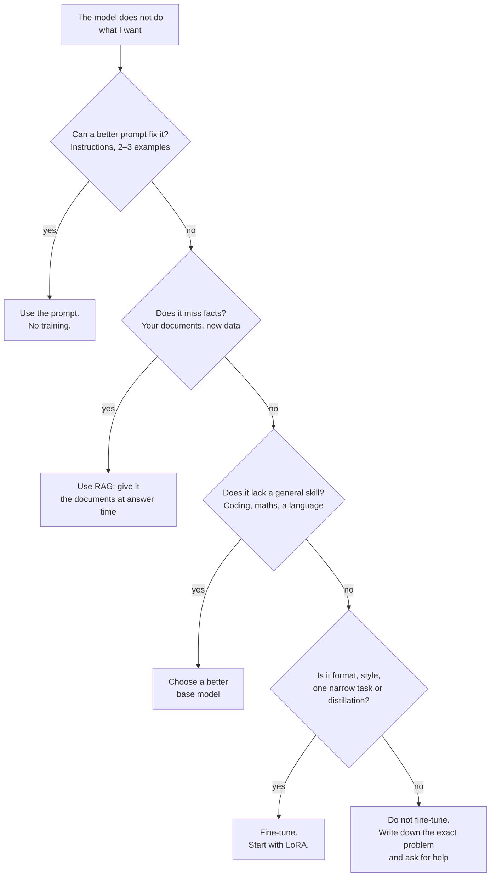

# Step 6: Fine-tune (optional)

Fine-tuning means training an existing model a little more on your own examples, so that it changes how it behaves. This page helps you decide whether you need it, then shows two paths: a small model trained fully on your Mac, and Inkling 2 Mini trained in the cloud and run on your Mac.

[Back to the learning base](README.md) · Previous: [Step 5: Optimise](5-optimise.md)

> **Not tested on this hardware.** Nobody has run these steps on an M1 Max 32 GB or any other computer for this page yet. They follow the linked tool documentation and notebooks. Memory numbers are source-reported or estimated, never measured here. If you try them, please share your results in [Discussions](https://github.com/jellydn/tiny-local-ai/discussions).

**Sources checked: 25 November 2026.** Training tools change quickly. Check the linked sources before a long run.

## Should I fine-tune?

Usually not first. Try a better prompt first. Then try giving the model your documents (RAG). Fine-tune only when both fail.

**RAG** (retrieval-augmented generation) means that a program finds the parts of your documents that match a question and pastes them into the prompt. The model reads the facts at answer time. You can change the documents at any time without training.



| Fine-tuning is good for | Fine-tuning is not good for |
| --- | --- |
| **Format:** always answer with the same JSON fields | **Facts:** product details, prices, last week's news. Use RAG. The model can mix up facts it learned in training, and you must train again each time they change. |
| **Style:** your tone, your length, your labels | **New general skills:** better coding, maths or reasoning. A small set of examples cannot teach these. Choose a better base model. |
| **One narrow task:** sort support tickets into 5 classes | **Fixing a model that does not fit or is too slow.** Training does not make a model smaller or faster. |
| **[Distillation](glossary.md#distillation):** teach a small, fast model to copy a bigger model on one task | **Things a prompt already fixes.** A prompt costs nothing to change. |

## Words on this page

Each term has a full entry in the [glossary](glossary.md#fine-tuning):

- [Full fine-tuning](glossary.md#full-fine-tuning) changes every weight. [LoRA](glossary.md#lora) trains a small [adapter](glossary.md#adapter) and keeps the original weights unchanged. [QLoRA](glossary.md#qlora) is LoRA on a 4-bit copy of the model.
- The [dataset](glossary.md#dataset-and-chat-format) is your list of example conversations. [Train on responses only](glossary.md#train-on-responses-only) means the model learns from the answers, not from the questions.
- The [eval split](glossary.md#eval-split) is the examples you keep out of training to check the result. [Overfitting](glossary.md#overfitting) is when the model memorises the training examples.
- To [merge](glossary.md#merge) is to add the adapter into the weights, so you get one normal model file.

## What every fine-tune needs

Both paths below use the same four parts.

### 1. A dataset

Write example conversations: a user message and the exact answer you want. Most trainers read **JSONL**: one JSON record on each line. This is the **chat format**:

```json
{"messages": [{"role": "user", "content": "Ticket: My card was charged twice for order 5521."}, {"role": "assistant", "content": "{\"category\": \"billing\", \"order_id\": \"5521\", \"urgent\": false}"}]}
```

- **Start with a few hundred good examples.** Liquid AI suggests 500 to 5,000 for a task, and says quality matters more than volume (source-reported, [Liquid fine-tuning overview](https://docs.liquid.ai/lfm/fine-tuning/overview)).
- **Use real inputs.** Copy the messy text that the model will see in real use.
- **Keep one format.** Every answer in the same structure, with the same field names.
- **Remove private data** that you do not want inside model weights.

### 2. An eval split

Before training, put about 10% of the examples in a validation file and another 10% in a test file. Never train on them. Split by source or topic, so near-copies do not end up in two files. If test examples leak into training, the score looks better than it is.

### 3. A baseline

Run the unchanged model on the test examples first and count correct answers. Use a script to check them, as in [Step 4](4-measure.md#check-quality-with-tests-not-impressions). Without a baseline, you cannot tell whether training helped.

### 4. A fair comparison after training

Run the same test examples on the fine-tuned model, with the same prompts and sampling. Then check that it did not get worse at other things: run a few general prompts too. Keep the fine-tune only when it beats the baseline on your task and does not break the general prompts.

## Path A: fully local, a small model with mlx-lm

This path trains a small model on an Apple silicon Mac with [mlx-lm](glossary.md#mlx-lm), the same engine as the [MLX path in Step 3b](3-run.md#another-path-an-mlx-model-with-mlx-lm). Use it to learn the whole process on one narrow task, such as turning support tickets into JSON.

**Why a small model:** training needs much more memory than running a model. It must also store the changes it computes for each trainable weight and the numbers it saves during each step. A model of about 1–8B parameters leaves room for this on a 32 GB Mac. The mlx-lm documentation reports that LoRA on a 7B model on an M1 Max 32 GB runs at about 250 tokens per second with `--batch-size 1 --num-layers 4` (source-reported). A 1–2B model needs much less memory (estimated).

**Which model:** this example uses [LiquidAI/LFM2.5-1.2B-Instruct-MLX-bf16](https://huggingface.co/LiquidAI/LFM2.5-1.2B-Instruct-MLX-bf16) (2.3 GB). The released mlx-lm 0.32.2 supports its architecture.

**LFM3-1.7B is the next step, but not yet.** [LFM3-1.7B](https://huggingface.co/LiquidAI/LFM3-1.7B) is made for fine-tuning to one task. When checked, mlx-lm 0.32.2 was the newest release, and it could not load LFM3. Support was merged in [ml-explore/mlx-lm#2016](https://github.com/ml-explore/mlx-lm/pull/2016) on 16 November 2026, after that release. When a newer release includes it, use `LiquidAI/LFM3-1.7B-MLX-bf16` in the same commands. Liquid AI's [MLX page](https://docs.liquid.ai/deployment/on-device/mlx) also lists MLX-VLM for LFM3 inference.

### A1. Install and download

From the `tiny-local-ai` folder of [Step 3b](3-run.md#make-a-working-folder), make a separate venv for training:

```bash
python3 -m venv .venv-train
.venv-train/bin/pip install "mlx-lm[train]==0.32.2"
.venv-train/bin/hf download LiquidAI/LFM2.5-1.2B-Instruct-MLX-bf16 \
  --local-dir models/LFM2.5-1.2B-Instruct-MLX-bf16
mkdir -p outputs/ticket-json/data
```

`[train]` adds the packages that training needs. The repository's `.gitignore` keeps `models/` and `outputs/` out of Git, so your data and adapters stay private.

### A2. Add your data

Put three files in `outputs/ticket-json/data/`, in the chat format above:

| File | Share | Use |
| --- | --- | --- |
| `train.jsonl` | about 80% | The model learns from it. |
| `valid.jsonl` | about 10% | mlx-lm reports the loss on it during training. |
| `test.jsonl` | about 10% | You check the final result once. |

Each example must be on one line.

### A3. Measure the baseline

Ask the unchanged model a few test inputs and save the answers:

```bash
.venv-train/bin/mlx_lm.generate --model models/LFM2.5-1.2B-Instruct-MLX-bf16 \
  --prompt "Ticket: My card was charged twice for order 5521." --max-tokens 200
```

For a real baseline, run every line of `test.jsonl` with a short script and count the answers that match.

### A4. Train a LoRA adapter

Run training in tmux, because it can take a while:

```bash
.venv-train/bin/mlx_lm.lora --model models/LFM2.5-1.2B-Instruct-MLX-bf16 \
  --train --data outputs/ticket-json/data \
  --adapter-path outputs/ticket-json/adapters \
  --mask-prompt --batch-size 1 --iters 300 \
  --steps-per-eval 50 --save-every 100
```

| Flag | Meaning |
| --- | --- |
| `--train` | Train a LoRA adapter. LoRA is the default type. |
| `--data` | The folder with `train.jsonl` and `valid.jsonl`. |
| `--adapter-path` | Where to save the adapter. |
| `--mask-prompt` | [Train on responses only](glossary.md#train-on-responses-only): the loss counts only the last message of each example. |
| `--batch-size 1` | One example per step. Uses the least memory. The default is 4. |
| `--iters 300` | 300 training steps. Increase it when the validation loss still falls at the end. |
| `--steps-per-eval 50` | Report the validation loss every 50 steps. |
| `--save-every 100` | Save the adapter every 100 steps, so a crash does not lose everything. |

**Watch two numbers:** the training loss and the validation loss. Both should fall. If the training loss keeps falling but the validation loss rises, the model is [overfitting](glossary.md#overfitting). Use fewer steps or more varied data.

**If it runs out of memory:** add `--grad-checkpoint` (less memory, slower), use `--num-layers 8` to train fewer layers (the default is 16), or make the examples shorter with `--max-seq-length`. Watch **Memory Pressure** in Activity Monitor, as in [Step 4](4-measure.md#read-the-memory-from-the-server-log).

### A5. Test the adapter

```bash
.venv-train/bin/mlx_lm.lora --model models/LFM2.5-1.2B-Instruct-MLX-bf16 \
  --adapter-path outputs/ticket-json/adapters \
  --data outputs/ticket-json/data --test
```

This prints the loss on `test.jsonl`. A lower loss is a good sign, but count correct answers too: run the same script as in A3 with `--adapter-path outputs/ticket-json/adapters` added to `mlx_lm.generate`. Compare the count with the baseline.

### A6. Use it

Serve the base model with the adapter. Every flag from [Step 3b](3-run.md#another-path-an-mlx-model-with-mlx-lm) still works:

```bash
.venv-train/bin/mlx_lm.server --model models/LFM2.5-1.2B-Instruct-MLX-bf16 \
  --adapter-path outputs/ticket-json/adapters --host 127.0.0.1 --port 8080
```

To get one model folder with the adapter inside, [merge](glossary.md#merge) it:

```bash
.venv-train/bin/mlx_lm.fuse --model models/LFM2.5-1.2B-Instruct-MLX-bf16 \
  --adapter-path outputs/ticket-json/adapters \
  --save-path outputs/ticket-json/fused
```

The result is an MLX model. The `--export-gguf` option of `mlx_lm.fuse` supports only Llama-, Mistral- and Mixtral-style models, so keep this one in MLX.

## Path B: Inkling 2 Mini, trained in the cloud and run on your Mac

This path trains a [QLoRA](glossary.md#qlora) adapter for Inkling 2 Mini with Unsloth's notebook on a rented cloud GPU, exports one GGUF file, and runs it on the Mac with the same llama.cpp settings as [Step 3b](3-run.md#5-move-to-the-long-context-start).

It is about **Inkling 2 Mini** (26.4B parameters). It is not about Inkling 2 Small: Unsloth reports that Small needs about 310 GB for its 4-bit weights alone. For a hosted alternative from Thinking Machines, see [Tinker in the main handbook](https://github.com/jellydn/tiny-local-ai#official-hosted-path-tinker).

### Why not train Inkling on a 32 GB M1?

Two reasons:

1. **The tested training code runs on CUDA.** CUDA is NVIDIA's GPU system. Unsloth's [Inkling 2 Mini fine-tuning guide](https://unsloth.ai/docs/models/inkling-2-mini/fine-tuning) tests its Inkling-specific memory savings only on NVIDIA GPUs: it loads the 128 experts in each layer as 4 bits and keeps the loop gates in 16 bits. Unsloth has a general MLX training path for Macs, but when checked, the Inkling guide did not document or test it for Inkling. A Mac has no CUDA.
2. **It does not fit.** Unsloth reports a peak of 21.1 GB on 24 GB GPUs, 25.7 GiB at 1,024 tokens and 29.4 GiB at 2,048 tokens (source-reported). The 32 GB M1 Max has a [Metal memory budget](glossary.md#metal-memory-budget) of 25.0 GiB for everything on the GPU. Even the lowest peak leaves almost no room, and the higher ones are above the budget.

The export also needs about 150 GB of free disk (see B4).

### B1. Choose where to train

| Where | Training | Export to GGUF |
| --- | --- | --- |
| [Colab A100 notebook](https://colab.research.google.com/github/unslothai/notebooks/blob/main/nb/Inkling_2_Mini_%2826B%29-Conversational.ipynb) (paid Colab plan with an A100) | Works | Works: about 21 minutes for a 17.48 GB `Q4_K_M` file (source-reported) |
| [Kaggle 2×T4 notebook](https://www.kaggle.com/notebooks/welcome?src=https://github.com/unslothai/notebooks/blob/main/nb/Kaggle-Inkling_2_Mini_%2826B%29-Conversational.ipynb&accelerator=nvidiaTeslaT4) (free) | Works, about 27 seconds per step | **Runs out of disk.** You can save only the adapter. |

Use the **Colab A100** notebook for this path. One T4 is not enough: the 4-bit weights alone are about 14.4 GB.

### B2. Put your data in the notebook

1. Open the notebook and upload your `train.jsonl` and `valid.jsonl` (chat format, as above).
2. In the data cell, load your file instead of the example dataset. The notebook formats each conversation with Inkling's own chat template (`apply_chat_template`). Keep that step: training and use must have the same format.
3. Keep `train_on_responses_only`. It is [train on responses only](glossary.md#train-on-responses-only) for Inkling's message markers.
4. Choose `reasoning_effort`. It sets how long Inkling thinks. Use the same value in training and in your tests.

### B3. Train

- The notebook trains for `max_steps = 30`. That is a quick check that everything works, not a real run. For a real run, the notebook says to set `num_train_epochs = 1` and `max_steps = None`.
- Keep `per_device_train_batch_size = 1` and raise `gradient_accumulation_steps` for a bigger effective batch. Unsloth says the 200K-token vocabulary makes this the largest memory use in each step.
- Watch the loss for [overfitting](glossary.md#overfitting), as in Path A.

### B4. Save the adapter, then export Q4_K_M

1. Run the save cell (`save_pretrained`). It saves only the small adapter. Download it as a backup.
2. In the GGUF cell, change `if False:` to `if True:` above `save_pretrained_gguf(..., quantization_method = "q4_k_m")`.

The export first [merges](glossary.md#merge) the adapter into a 53 GB 16-bit model, then writes a 53 GB 16-bit GGUF, then makes the 4-bit file. That is why it needs **about 150 GB of free disk**. The final [`Q4_K_M`](glossary.md#q4_k_m) file is about 17.5 GB (source-reported).

3. Move the file to your Mac. Two options: copy it to Google Drive and download it, or upload it to a private Hugging Face repository with the notebook's `push_to_hub_gguf` cell and download it with `hf download`. Put it in `models/inkling-2-mini-ft/`.

### B5. Run it on the Mac

Use the long-context launch from [Step 3b](3-run.md#5-move-to-the-long-context-start): the Unsloth build, `-ub 256`, q8_0 KV and 128K context. Change only the file and the alias:

```bash
./runtime/llama-b12588-mix-c0c3de8/llama-server \
  -m models/inkling-2-mini-ft/<your-file>-Q4_K_M.gguf \
  -c 131072 -np 1 -ngl 99 -fa on --fit off \
  -ub 256 -ctk q8_0 -ctv q8_0 --cache-ram 0 \
  --temp 1.0 --top-p 1.0 --top-k 0 --min-p 0.0 \
  --jinja --alias inkling-2-mini-ft --host 127.0.0.1 --port 8080
```

- **Memory:** the 17.5 GB file is a little smaller than the 17.63 GB `UD-Q4_K_XL` file, so the same launch should fit (estimated). Read the `buffer size` lines to check, as in [Step 4](4-measure.md#read-the-memory-from-the-server-log).
- **Build:** the notebook exports with Unsloth's own llama.cpp. Nobody has checked that the Mac build `b12588-mix-c0c3de8` reads that file. If it fails to load or writes random characters, see [why that build](worked-example-m1-max-32gb.md#why-that-build) and use the Unsloth build that the notebook names.
- **One model at a time.** Two 17 GB models do not fit in 32 GB together. Stop one server before you start the other.

### B6. Compare it with the base model

Run the same tests on the base model and on the fine-tune, one server at a time, with the same sampling and `reasoning_effort`:

1. **Your task:** every example in `test.jsonl`. This shows the gain.
2. **The 6-prompt check:** the six checkable prompts from [Step 4](4-measure.md#check-quality-with-tests-not-impressions), listed in [Discussion #5](https://github.com/jellydn/tiny-local-ai/discussions/5). The base model scored 6/6 on them (measured). If the fine-tune scores less, training damaged its general skills.
3. **Speed:** decode and prefill as in [Step 4](4-measure.md#read-the-speed-from-the-api). A LoRA fine-tune should not change speed much, but the quant type differs.

The base tests used `UD-Q4_K_XL`, and the fine-tune is a plain `Q4_K_M`. For a fairer comparison, also test the base model's `UD-Q4_K_M` file (16.61 GB) from [unsloth/Inkling-2-Mini-GGUF](https://huggingface.co/unsloth/Inkling-2-Mini-GGUF).

Keep the fine-tune only when it wins on your task and still passes the six prompts. Record everything as in [Step 4](4-measure.md#record-every-result), plus the dataset version, the number of steps and the notebook version.

## If the fine-tune is worse

| What you see | Likely cause | What to try |
| --- | --- | --- |
| Great on training examples, bad on test examples | [Overfitting](glossary.md#overfitting) | Fewer steps, more varied examples |
| Test score looks too good to be true | Test examples leaked into training | Split again by source or topic |
| Answers have the wrong format or strange tokens | Training and use used different chat templates | Use the model's own chat template everywhere |
| Task improves, general prompts get worse | Too many steps or a too high learning rate | Fewer steps, a lower learning rate |
| It still invents facts | Fine-tuning does not add reliable facts | Use RAG instead |

## Read more

- [Unsloth: Fine-tuning Inkling 2 Mini](https://unsloth.ai/docs/models/inkling-2-mini/fine-tuning), the source for Path B's memory, disk and export numbers
- [Unsloth: Fine-tuning LLMs guide](https://unsloth.ai/docs/get-started/fine-tuning-llms-guide) and [LoRA hyperparameters guide](https://unsloth.ai/docs/get-started/fine-tuning-llms-guide/lora-hyperparameters-guide)
- [mlx-lm: Fine-tuning with LoRA or QLoRA](https://github.com/ml-explore/mlx-lm/blob/main/mlx_lm/LORA.md), the source for Path A's commands
- [Liquid AI: Fine-tune LFMs](https://docs.liquid.ai/lfm/fine-tuning/overview)
- [Main handbook: fine-tuning Inkling 2 Mini](https://github.com/jellydn/tiny-local-ai#fine-tuning-inkling-2-mini), including the hosted Tinker path
