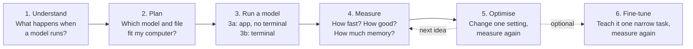

# Learn to run local AI models

This is a learning base for people who start from zero. It teaches you how to run an AI model on your own computer, step by step. Every page explains its terms in plain words.

Read it on the [website](https://jellydn.github.io/tiny-local-ai/) or here on GitHub.

**Sources checked: 22 November 2026.** Models and tools change quickly. Check the linked sources before you download large files.

## Who this is for

You can use a terminal and copy commands. You do not need to know how AI models work. If a word is new, look it up in the [glossary](glossary.md).

## The learning path

Follow the five steps in order. Each step answers one question. Step 3 has two paths: start with the app (3a) if you are new, and use the terminal (3b) when you need more control. Step 6 is optional: most people never need it.

| Step | What you do in plain words | Page |
| --- | --- | --- |
| 1. Understand | Read how a model uses memory and why it is fast or slow. No commands yet. | [Understand](1-understand.md) |
| 2. Plan | Choose a model and a file size that fit your computer, before you download anything. | [Plan](2-plan.md) |
| 3a. No-terminal start | Install the Unsloth Desktop app, pick a model from a list and chat. No commands. | [No-terminal start](3a-unsloth-desktop.md) |
| 3b. Run a model in the terminal | Type the commands: install the program, download the model, start it and ask it a question. Gives full control over memory. | [Run a model](3-run.md) |
| 4. Measure | Check how fast it answers, how much memory it uses and whether its answers are correct. | [Measure](4-measure.md) |
| 5. Optimise | Change one setting at a time and keep only the changes that make it better. | [Optimise](5-optimise.md) |
| 6. Fine-tune (optional) | Decide whether you need training at all. If you do, train a small adapter for one narrow task and compare it with the original model. | [Fine-tune](6-fine-tune.md) |

## Reference pages

- [Glossary](glossary.md): every term, with a simple explanation and an example.
- [Worked example: three models on an M1 Max 32 GB](worked-example-m1-max-32gb.md): real results and the lessons from them.
- [FAQ and troubleshooting](faq.md): common questions and fixes for common errors.

## How to read the numbers

This learning base uses three labels:

- **Measured:** someone ran it and recorded the result. The source is linked.
- **Source-reported:** a model card or tool documentation states it.
- **Estimated:** a calculation or rule of thumb. Use it to plan, then measure.

The M1 Max results come from the author's [Discussions #3](https://github.com/jellydn/tiny-local-ai/discussions/3), [#4](https://github.com/jellydn/tiny-local-ai/discussions/4) and [#5](https://github.com/jellydn/tiny-local-ai/discussions/5), and from [sybil-solutions/local-ai-registry PR #466](https://github.com/sybil-solutions/local-ai-registry/pull/466), [PR #470](https://github.com/sybil-solutions/local-ai-registry/pull/470) and [PR #475](https://github.com/sybil-solutions/local-ai-registry/pull/475). They were not rerun for this learning base. Your computer will give different numbers.

The no-terminal page, the memory size table and the quantization picture use Jerry James's [A beginner's guide to Local AI with Inkling, Qwen, and Unsloth](https://www.gpupartner.com/blog/beginners-guide-local-ai-inkling-qwen-unsloth) (GPU Partner, 22 November 2026) as a reference. The text, table and picture here are our own.

## Scope

Steps 1–5 cover **local inference**: running an existing model on your computer. [Step 6](6-fine-tune.md) covers fine-tuning: a small model trained on your Mac, or Inkling 2 Mini trained in the cloud and run on your Mac. Training a model from scratch is a different task. The [main handbook](https://github.com/jellydn/tiny-local-ai#train-a-small-model-from-scratch) introduces it.
