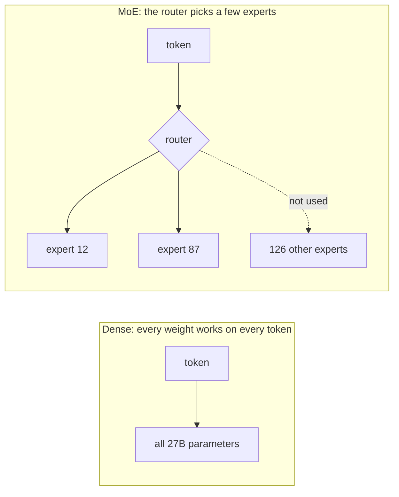
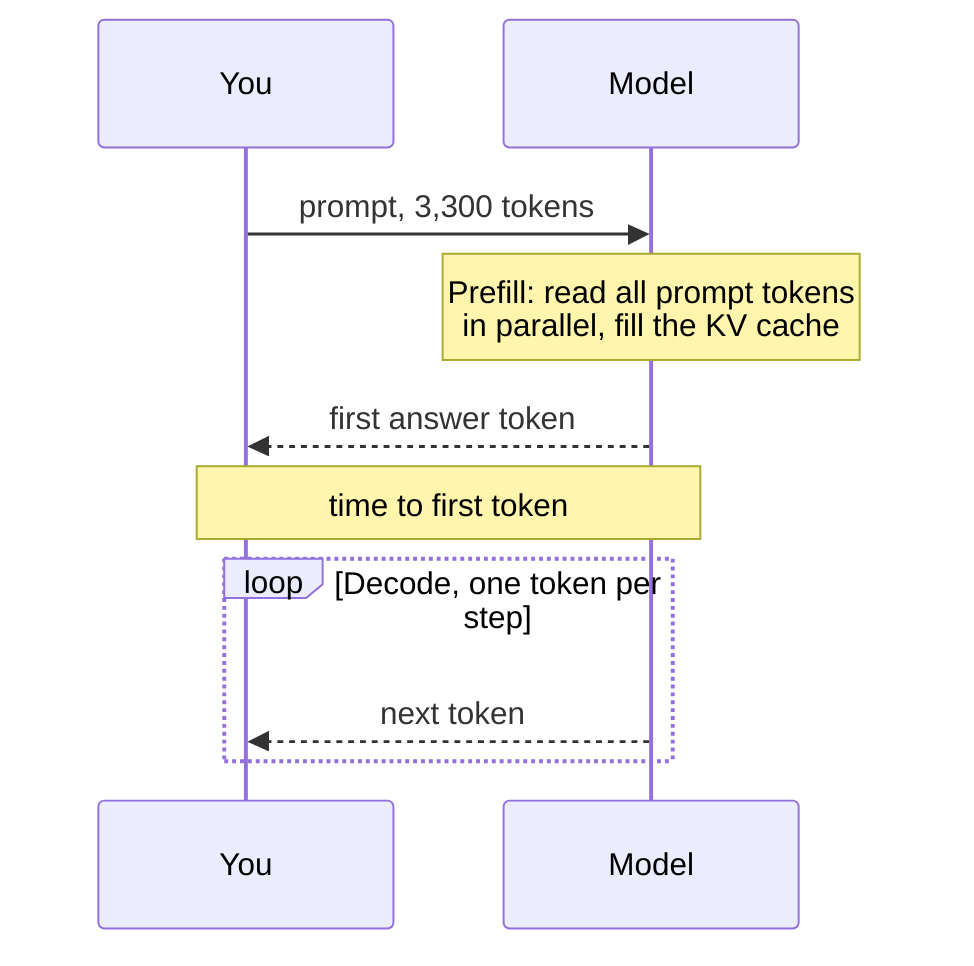
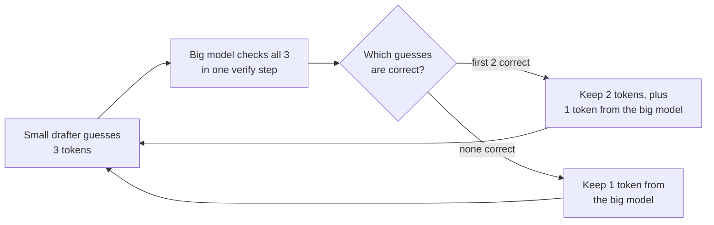
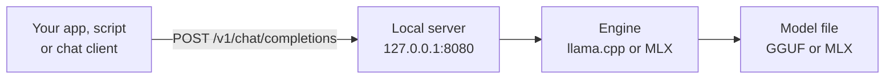

# Glossary

Each term has a short explanation and an example. The examples use the [M1 Max 32 GB results](worked-example-m1-max-32gb.md) where possible.

[Back to the learning base](README.md)

**Jump to:** [Model basics](#model-basics) · [Model files and quantization](#model-files-and-quantization) · [Memory](#memory) · [Speed](#speed) · [Speculative decoding](#speculative-decoding) · [Engines and servers](#engines-and-servers) · [Quality](#quality)

## Model basics

### Model and weights

A **model** is a large list of numbers plus the code that uses them. The numbers are called **weights**. Training sets the weights. When you run a model, the weights do not change.

*Example:* the Inkling 2 Mini file `Inkling-2-Mini-UD-Q4_K_XL.gguf` holds its weights. It is 17.63 GB.

### Token

A **token** is a small piece of text. It can be a whole word, part of a word or a punctuation mark. Models read and write tokens, not letters. In English, 100 tokens is roughly 75 words.

*Example:* "unbelievable" can be three tokens: `un`, `believ`, `able`.

### Inference

**Inference** means running a model to get an answer. Everything in this learning base is inference. Training and fine-tuning change the weights; inference does not.

### Parameters

A **parameter** is one weight. Model sizes count parameters in billions, written **B**. More parameters usually means more knowledge, a bigger file and slower speed.

*Example:* Qwen3.8-27B has 27 billion parameters.

### Dense vs MoE

A **dense** model uses all of its parameters for every token.

A **Mixture-of-Experts (MoE)** model splits many of its layers into small blocks called **experts**. For each token, a small **router** picks a few experts. The other experts do no work for that token.

*Example:* Qwen3.8-27B is dense. Inkling 2 Mini is MoE: each layer sends each token to 8 of 128 experts.

### Active parameters

**Active parameters** are the parameters that do work for one token. In a dense model, active = total. In an MoE model, active is much smaller than total.

Active parameters mostly decide **speed**. Total parameters decide **memory**, because every expert must be in memory: the next token may need any of them.

*Example:* LFM2.5-24B-A2B has 24B total and about 2.4B active ("A2B" in the name means about 2B active). It needs memory for 24B, but it runs about as fast as a small model: 68.9 tokens per second on the M1 Max, against 15 for dense Qwen3.8-27B.

## Model files and quantization

### Quantization

**Quantization** stores each weight with fewer bits. This makes the file smaller and faster to read. It also makes each weight less exact, so quality can drop a little. A common target is about 4 bits per weight instead of the original 16.

*Analogy:* a photo saved as a smaller JPEG. It looks almost the same, but some detail is gone.

### Bits per weight (bpw)

**Bits per weight** is the average storage for one weight, including extra numbers such as scales. Use it to estimate file size:

> file size in GB ≈ parameters in billions × bits per weight ÷ 8

*Example:* 26.4B × 5.3 bpw ÷ 8 ≈ 17.5 GB. The Inkling 2 Mini `UD-Q4_K_XL` file is 17.63 GB, so it averages about 5.3 bpw. "Q4" does not mean exactly 4 bits.

### GGUF

**GGUF** is a single-file model format used by llama.cpp and the apps built on it. One `.gguf` file holds the weights, the tokenizer and settings. The quant type is in the file name.

### Q4_K_M

**Q4_K_M** is a common llama.cpp quant type. "Q4" means mostly 4-bit weights. "K" is the k-quant method, which stores weights in small blocks with their own scales. "M" means medium: some sensitive tensors keep more bits. It averages a little under 5 bpw (estimated). It is a good default when you do not know which quant to choose.

### UD-Q4_K_XL

**UD-Q4_K_XL** is an Unsloth "Dynamic" quant. Unsloth measures which layers are sensitive and gives them more bits; other layers get fewer. "XL" means more layers keep higher precision than in "M". The worked examples use this quant for Inkling 2 Mini and Qwen3.8-27B.

### MLX format

**MLX** is Apple's machine learning framework for Apple silicon. MLX models are folders of `.safetensors` files, not GGUF. An MLX "4-bit" model with group size 64 averages 4.5 bpw, because each group of 64 weights also stores a scale and an offset. A "6-bit" model with group size 64 averages 6.5 bpw.

*Example:* `LiquidAI/LFM2.5-24B-A2B-MLX-6bit` is 19.5 GB at 6.5 bpw.

### NVFP4

**NVFP4** is a 4-bit floating-point format from NVIDIA. Each block of 16 weights shares one 8-bit scale, so it averages 4.5 bpw. Some models are trained directly in this format. Inkling 2 Mini was trained natively in NVFP4, with its last 4 layers in MXFP8, an 8-bit format.

NVFP4 needs runtime support. Mainline llama.cpp gave wrong output on the Inkling quants when checked; the Unsloth build was required. See the [worked example](worked-example-m1-max-32gb.md#why-that-build).

## Memory

### Context window

The **context window** is the maximum number of tokens the model can see at once: your prompt, the chat history and the answer together. A model card states the maximum. You choose the size you use at launch, and a bigger window needs more memory.

*Example:* Inkling 2 Mini supports up to 1M tokens. On a 32 GB Mac, the tested launch used `-c 131072`, which is 128K tokens.

### KV cache

When the model reads tokens, it saves some numbers for each token so it does not compute them again. These are the **keys** and **values** of attention, so this memory is called the **KV cache**. It grows with the context window.

> KV cache bytes ≈ 2 × layers with KV × KV heads × head size × bytes per value × context tokens

*Example:* LFM2.5-24B-A2B has 10 attention layers with 8 KV heads of size 64. At 128K tokens and 2 bytes per value (f16): 2 × 10 × 8 × 64 × 2 × 131,072 ≈ 2.7 GB, which is 2.5 GiB. Its other 30 layers keep no KV cache, so the cache is small.

### q8_0 KV

By default, llama.cpp stores the KV cache in **f16** (16 bits per value). **q8_0** stores it in 8 bits with a scale per block, so the cache becomes about half the size. Set it with `-ctk q8_0 -ctv q8_0`. This is a small quality trade; test it on your tasks.

*Example:* for Inkling 2 Mini at 128K, the KV cache went from 4,296 MiB (f16) to 2,282 MiB (q8_0). This change made the launch fit.

### Unified memory

On Apple silicon, the CPU and GPU share one pool of memory. This is **unified memory**. A 32 GB Mac does not have separate graphics memory; the model and macOS share the same 32 GB.

On a PC with an NVIDIA or AMD card, the GPU has its own **VRAM**. A model is fastest when it fits fully in VRAM.

### Metal memory budget

**Metal** is Apple's GPU interface. macOS limits how much unified memory the GPU may use. This limit is the **Metal memory budget**, also called the recommended working set. llama.cpp prints it as `recommendedMaxWorkingSetSize` when it starts.

*Example:* on the 32 GB M1 Max, the budget was 25.0 GiB (25,558 MiB). The model weights, KV cache and compute buffers must all fit inside it. The full 32 GB is not available to the GPU.

### Compute buffer

The **compute buffer** is scratch memory for the math of one step. Its size depends on the model and on the ubatch size. llama.cpp prints it at startup.

### Batch and ubatch (`-b`, `-ub`)

During prefill, llama.cpp processes the prompt in chunks. The **batch** (`-b`, default 2048) is the largest chunk it accepts at once. The **ubatch** or micro-batch (`-ub`, default 512) is the chunk the GPU really computes in one pass. A bigger ubatch usually gives faster prefill but needs a bigger compute buffer.

*Example:* for Inkling 2 Mini at 128K, `-ub 512` needed a 6,118 MiB compute buffer and `-ub 256` needed 4,712 MiB. MLX has a similar setting called `--prefill-step-size` (default 2048).

### Slots and parallel requests (`-np`)

A **slot** serves one request at a time. `-np 1` means one slot. More slots let several users share the server, but each slot needs its own share of context memory.

### OOM

**OOM** means **out of memory**. The program asked for more memory than it may use, so it stopped. On a Mac, this often happens at "warmup", when the server runs its first test pass. Look for messages such as `failed to allocate` or `Insufficient Memory` in the log.

*Example:* the default Inkling 2 Mini launch at 128K needed 26,786 MiB, above the 25,558 MiB budget, so it hit OOM at warmup.

### Swap

When memory is full, macOS moves some data to disk. This is **swap**. A small, flat swap is fine. Swap that keeps growing while the model runs makes everything slow.

## Speed

### Prefill vs decode

Generation has two phases:

1. **Prefill** (prompt processing): the model reads your whole prompt and fills the KV cache. It can process many tokens in parallel, so it is fast per token. Its speed is limited mostly by GPU **compute**.
2. **Decode** (generation): the model writes the answer one token at a time. For each token it must read the active weights from memory. Its speed is limited mostly by **memory bandwidth**.

### Tokens per second (tok/s)

**Tokens per second** measures speed. Always say which phase you measured.

- **Decode tok/s** is how fast the answer appears. About 10 tok/s is near reading speed; 20 tok/s feels smooth.
- **Prefill tok/s** is how fast the model reads input. It matters when you paste long documents.

*Example:* Inkling 2 Mini on the M1 Max: 20.5 tok/s decode, 202.6 tok/s prefill on a 3.3K-token prompt.

### Time to first token (TTFT)

**TTFT** is the wait between sending a request and seeing the first answer token. For a long prompt, prefill makes up most of it.

> TTFT ≈ prompt tokens ÷ prefill tok/s

*Example:* a 25,500-token prompt at 146.5 tok/s prefill waits about 174 seconds before the first token.

### Bandwidth ceiling

The **bandwidth ceiling** is the best possible decode speed: memory bandwidth ÷ bytes read per token. Real speed is always lower. Use it to see whether a setting can still help.

*Example:* the M1 Max measured 353 GB/s. Dense Qwen3.8-27B reads about 16.5 GB per token, so its ceiling is about 21 tok/s. It reached 11.9 tok/s without speculation, 57% of the ceiling.

## Speculative decoding

### Speculative decoding

Decode is slow because the big model makes one token per step. **Speculative decoding** lets a small, fast helper guess the next few tokens. The big model then checks all the guesses in one step and keeps the correct ones. The final text is the same as without speculation; only the speed changes.

It helps only when one verify step for k tokens costs much less than k normal steps. See [why DSpark was slower](worked-example-m1-max-32gb.md#why-dspark-was-slower).

### Draft model

A **draft model** (drafter) is the small model that makes the guesses. It must use the same tokenizer as the main model.

*Example:* no drafter exists for LFM2.5-24B-A2B: the small LFM2.5 models have a 65,536-token vocabulary, and this model has 128,000.

### MTP (multi-token prediction)

**MTP** is a drafter built into the model itself: an extra layer trained to predict tokens further ahead. No separate file is needed.

*Example:* Qwen3.8-27B has one MTP layer. With `--spec-type draft-mtp --spec-draft-n-max 3`, decode rose from 11.9 to about 15 tok/s.

### DSpark

**DSpark** is a speculative decoding method that drafts several tokens at once and verifies them by confidence. Inkling 2 Mini ships a DSpark drafter, and the DeepSeek V4.1 Flash card also lists it.

*Example:* on the M1 Max, DSpark made Inkling 2 Mini slower: 15–17 tok/s against 20.5 without it.

### DFlash2

**DFlash2** is a block-diffusion drafter from z-lab. It drafts a block of tokens in one pass. When checked, the only DFlash2 checkpoint was for Qwen3.8-27B, and it ran in an MLX-VLM fork.

*Example:* with block size 3, DFlash2 reached 24.3 tok/s on short prompts. With 4 or more tokens per block it fell to 2.7–6.5 tok/s on the M1.

### Acceptance rate

The **acceptance rate** is the share of drafted tokens that the big model keeps. Higher is better, but it is not enough on its own: the verify step must also be cheap.

*Example:* Qwen MTP accepted 63% of drafts with 1 draft and about 40% with 3. Three drafts were still fastest, because they gave about 2.2 tokens per step.

## Engines and servers

### Engine (runtime)

An **engine** is the program that loads the model file and runs it. The engine must support both the model's architecture and its file format.

### llama.cpp

**llama.cpp** is an open-source engine for GGUF files. It runs on Apple Metal, NVIDIA CUDA, AMD, Vulkan and plain CPU. Its `llama-server` program serves a web chat page and an API. Many desktop apps use it inside. Builds are named by number, such as `b12588`.

### mlx-lm

**mlx-lm** is Apple's engine for text models in MLX format. `mlx_lm.server` serves an API. It runs only on Apple silicon.

### mlx-vlm

**mlx-vlm** runs vision-language models (text plus images) in MLX format. The worked examples used a community fork, [Neywa-Labs/mlx-vlm](https://github.com/Neywa-Labs/mlx-vlm), for Inkling 2 Mini, Qwen3.8-27B and DFlash2.

### OpenAI-compatible server

An **OpenAI-compatible server** accepts the same HTTP requests as the OpenAI API. Any tool that can talk to OpenAI can talk to it: change the base URL to your local server. The usual endpoints are `/v1/models` (list models) and `/v1/chat/completions` (send a chat). Both `llama-server` and `mlx_lm.server` provide them.

## Quality

### KL divergence (KLD)

**KL divergence** measures how different two sets of predictions are. For quants, it compares the quant's next-token probabilities with those of a high-precision reference. 0 means identical. Smaller is better. Quant makers often report it with the **top-token match**: how often both pick the same most likely token.

*Example:* Unsloth reports a mean KLD of 0.0107 and a 98.0% top-token match for Inkling 2 Mini `UD-Q4_K_XL` against its 8-bit reference (source-reported).

### Needle recall

A **needle test** hides a fact, such as a 5-digit code, in a long document and asks the model to find it. It checks that the model can use a long context. Passing one needle test does not prove quality across the whole window.

*Example:* Inkling 2 Mini recalled the code `58213` from a 91,890-token prompt.

### Sampling settings

**Sampling** decides how the model picks each token from its predictions. **Temperature** controls randomness: 0 always picks the most likely token; 1.0 follows the model's probabilities. **top-p**, **top-k** and **min-p** remove unlikely tokens. Use the values from the model card, and keep them fixed when you compare.
