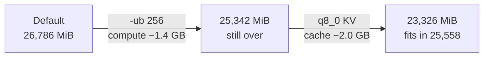

# Worked example: three models on an M1 Max 32 GB

This page walks through real results from one Mac. It shows how the ideas from the learning path work in practice, and what went wrong on the way. It summarises the reports; the full numbers, logs and methods are in the linked discussions and pull requests.

[Back to the learning base](README.md)

**Machine:** MacBook Pro 16-inch (2021), M1 Max, 32-core GPU, 32 GB unified memory, macOS 26.6.2, on AC power. About 14 GiB was used by other desktop apps the whole time.

**Status:** all numbers are **measured by the author** and reported in the linked sources, checked 22 November 2026. The MTPLX and LookAtMyQuant drafter results and the Mac notes were checked on 23 November 2026. They were not rerun for this page. The three [registry](glossary.md#registry-recipe-and-lab-gates) pull requests were open when checked.

## The three models at a glance

| | Inkling 2 Mini | Qwen3.8-27B | LFM2.5-24B-A2B |
| --- | --- | --- | --- |
| Architecture | [Looped](glossary.md#looped-layers) MoE, 26.4B total / 3.4B active | Dense, 27B, all active; most layers use [linear attention](glossary.md#linear-attention) | MoE, 24B total / about 2.4B active; most layers keep no KV cache |
| File | Unsloth `UD-Q4_K_XL` GGUF, 17.6 GB | Unsloth `UD-Q4_K_XL` GGUF, 17.7 GB | Liquid AI MLX 6-bit, 19.5 GB |
| Engine | Unsloth llama.cpp `b12588-mix-c0c3de8` | Same build, with built-in MTP | `mlx-lm` 0.32.2 |
| Context | 128K | 128K | 128K |
| Decode (benchmark median) | **20.5 tok/s** | **about 15 tok/s** with MTP, 11.9 without | **68.9 tok/s** |
| Prefill, short prompt | 202.6 tok/s at 3.3K | 124.1 tok/s at 2.8K | about 970 tok/s at 2.9K |
| Longest needle recalled | 91,890 tokens | 106,294 tokens | 91,882 tokens |
| Details | [Discussion #3](https://github.com/jellydn/tiny-local-ai/discussions/3), [sybil-solutions/local-ai-registry PR #466](https://github.com/sybil-solutions/local-ai-registry/pull/466) | [Discussion #4](https://github.com/jellydn/tiny-local-ai/discussions/4), [sybil-solutions/local-ai-registry PR #470](https://github.com/sybil-solutions/local-ai-registry/pull/470) | [Discussion #5](https://github.com/jellydn/tiny-local-ai/discussions/5), [sybil-solutions/local-ai-registry PR #475](https://github.com/sybil-solutions/local-ai-registry/pull/475) |

The registry's [speed gate](glossary.md#registry-recipe-and-lab-gates) uses a different prompt and method, so it gives different numbers: 20.1, 17.6 and 67.0 tok/s. Keep the two sets of numbers separate.

The decode speeds follow the [active parameters](glossary.md#active-parameters). Per token, LFM reads about 2 GB, Inkling about 4 GB and dense Qwen about 16.5 GB. That explains most of the speed gap.

## Mac notes

A common tip is "on a Mac, use MLX". [MLX](glossary.md#mlx-format) is Apple's own framework, and it often reads prompts faster. On this 32 GB M1 Max the tip held only for short prompts. For long context it did not hold, with one exception.

*Measured by the author, from the comments on [Discussion #3](https://github.com/jellydn/tiny-local-ai/discussions/3) and [Discussion #4](https://github.com/jellydn/tiny-local-ai/discussions/4), checked 23 November 2026:*

| Model | Engine | Longest context that worked | What happened above it |
| --- | --- | --- | --- |
| Inkling 2 Mini | MLX ([Neywa-Labs/mlx-vlm](https://github.com/Neywa-Labs/mlx-vlm) fork) | 25.7K | Out of memory at about 52K. No 8-bit KV cache for this model. |
| Inkling 2 Mini | [LookAtMyQuant](#lookatmyquant) (MLX), no drafter | 28K | Out of memory at 32K |
| Inkling 2 Mini | LookAtMyQuant + drafter, with an FP8 KV cache | 64K | Fit, but slower than llama.cpp from 25K. See [the drafter fix](#update-the-drafter-now-runs-on-m1). |
| Qwen3.8-27B | MLX (mlx-vlm fork), with or without DFlash2 | 22.7K | Out of memory at about 32K (DFlash2) and 49K (plain) |
| Qwen3.8-27B | [MTPLX](#newer-result-mtplx-with-mtp) v2.13.1 (MLX) | 36K, and only with `--allow-swap` | Failed at 50K and 64K |
| Inkling 2 Mini | **llama.cpp**, Unsloth build | **128K** (needle found at 91,890 tokens) | — |
| Qwen3.8-27B | **llama.cpp** + MTP, Unsloth build | **128K** (needle found at 106,294 tokens) | — |
| LFM2.5-24B-A2B | **mlx-lm** 0.32.2 | **128K**, at 68.9 tok/s | — |

What this means:

- **MLX ran out of memory at about 32K–52K tokens** for Inkling and Qwen. llama.cpp was the only engine that served 128K for them, because it can store the [KV cache](glossary.md#kv-cache) in 8 bits (q8_0) and use a small micro-batch.
- **LFM2.5-24B-A2B on mlx-lm was the exception.** Only 10 of its 40 layers keep a KV cache, so its cache is only about 2.5 GiB at 128K, even in 16 bits. MLX was the best engine for this model: 68.9 tok/s at 128K.
- **128K on Inkling needs `-ub 256` and a q8_0 KV cache.** With the default settings, llama.cpp asked for 26,786 MiB, more than the ~25 GiB (25,558 MiB) [Metal budget](glossary.md#metal-memory-budget). Both changes together brought it to 23,326 MiB. See [why the defaults ran out of memory](#why-the-defaults-ran-out-of-memory).
- **Inkling needs Unsloth's llama.cpp build.** The official (mainline) llama.cpp loaded the file but gave wrong output. See [why that build](#why-that-build).
- **MLX did win on short prompts.** MLX-based engines read prompts up to about 2.4 times faster, and two of them decoded faster than llama.cpp under about 25K tokens ([MTPLX](#newer-result-mtplx-with-mtp) for Qwen and the [LookAtMyQuant drafter](#update-the-drafter-now-runs-on-m1) for Inkling).

**Rule for a 32 GB Mac:** pick the engine by prompt length and by the model's KV cache size, not by the brand of your computer. For long context, choose the engine with the smallest KV cache for that model.

## Inkling 2 Mini with llama.cpp

The tested launch:

```bash
llama-server -m Inkling-2-Mini-UD-Q4_K_XL.gguf \
  -c 131072 -np 1 -ngl 99 -fa on --fit off \
  -ub 256 -ctk q8_0 -ctv q8_0 --cache-ram 0 \
  --temp 1.0 --top-p 1.0 --top-k 0 --min-p 0.0 \
  --jinja --alias inkling-2-mini --host 127.0.0.1 --port 8080
```

[Step 3b](3-run.md#5-move-to-the-long-context-start) explains every flag.

### Why that build

The official llama.cpp ([mainline](glossary.md#build-mainline-and-fork)) could read the file but wrote gibberish when checked. In [NVFP4](glossary.md#nvfp4), each block of 16 weights shares one "scale" number. Mainline llama.cpp lost these scales when it ran the [looped layers](glossary.md#looped-layers) the second and third time, so the weights became wrong. The fix was in [ggml-org/llama.cpp#32704](https://github.com/ggml-org/llama.cpp/pull/32704), not yet merged at the time. Unsloth's build `b12588-mix-c0c3de8` had the fix and GPU code ([kernels](glossary.md#kernel)) for NVFP4 on Mac.

**Lesson:** the engine must match the model and the file. Use the build that the maker of the file (here Unsloth) names, and do not mix files and builds from different guides.

### Why the defaults ran out of memory

macOS gave the GPU a [Metal budget](glossary.md#metal-memory-budget) of 25.0 GiB (25,558 MiB). The server log showed these buffers:

| Launch | Weights | KV cache | Compute | Total (MiB) | Result |
| --- | ---: | ---: | ---: | ---: | --- |
| Default: `-ub 512`, [f16](glossary.md#f16-and-q8_0-kv) KV | 16,332 | 4,336 | 6,118 | 26,786 | [OOM](glossary.md#oom) at warmup (first test pass) |
| `-ub 256`, f16 KV | 16,332 | 4,296 | 4,714 | 25,342 | OOM at warmup |
| `-ub 256`, q8_0 KV | 16,332 | 2,282 | 4,712 | **23,326** | Runs |



All numbers in this table are MiB (see [GB, GiB and MiB](glossary.md#gb-gib-and-mib)). Inkling's compute buffer (scratch memory) is unusually large, because its attention adds a learned position score (a "relative-position bias") that covers the whole context window. So both changes were needed.

**Lessons:** the Metal budget, not the 32 GB of RAM, is the limit. Add up the `buffer size` lines. Fix the biggest part first.

### Why DSpark was slower

Unsloth's guide suggests the DSpark [drafter](glossary.md#dspark). On this Mac it made decode slower: 15.0–17.0 tok/s against 20.4–20.8 without it. The guide's own 32K launch with DSpark was also slower: 15.4 against 20.9.

The reason is cost, not acceptance. One draft token was accepted 58% of the time, which gives 1.58 tokens per step. But a two-token verify step cost 1.98 times a one-token step. In this MoE model, each checked token picks its own 8 of 128 experts in all 48 looped layer passes. The checked tokens share almost no work, so checking several tokens in one step costs about as much as making them one by one.

**Lesson:** speculation pays only when checking several drafted tokens in one step costs much less than making them one by one. Measure it on your exact engine and GPU.

### Why llama.cpp beat MLX for 128K

The author also ran Inkling 2 Mini in the [Neywa-Labs/mlx-vlm](https://github.com/Neywa-Labs/mlx-vlm) fork with NVFP4 MLX weights ([comment on Discussion #3](https://github.com/jellydn/tiny-local-ai/discussions/3)).

- MLX **prefilled 1.6–1.9 times faster** at 8K–26K tokens.
- llama.cpp **decoded 10–20% faster** at every length.
- MLX **ran out of memory at about 52K tokens**. That fork could not use a quantized KV cache for Inkling, so its f16 cache grew too large. llama.cpp with q8_0 KV still worked at 66K and passed the 91,890-token needle test.

The same pattern held for Qwen3.8-27B ([comment on Discussion #4](https://github.com/jellydn/tiny-local-ai/discussions/4)): the MLX runs failed at about 32K–49K tokens, and llama.cpp reached 58K in that test and 106K in the lab gate.

**Lesson:** the right engine depends on your prompt length. For work with long prompts and short answers, under about 40K tokens, MLX can be better. For long context on 32 GB, the engine with the smaller KV cache wins. The [Mac notes](#mac-notes) compare every engine that was tested.

## Qwen3.8-27B with built-in MTP

Same build and settings as Inkling, plus the model's built-in [MTP](glossary.md#mtp-multi-token-prediction) head (an extra layer that guesses future tokens):

```bash
llama-server -m Qwen3.8-27B-UD-Q4_K_XL.gguf \
  --spec-type draft-mtp --spec-draft-n-max 3 \
  -c 131072 -np 1 -ngl 99 -fa on --fit off \
  -ub 256 -ctk q8_0 -ctv q8_0 --cache-ram 0 \
  --temp 1.0 --top-p 0.95 --top-k 20 --min-p 0.0 \
  --jinja --alias qwen3.8-27b --host 127.0.0.1 --port 8080
```

What it shows:

- **Speculation worked here.** Three MTP drafts raised decode from 11.9 to about 15 tok/s (+26–37%). Qwen is dense, so all drafted tokens share one weight read, and a four-token verify step cost only about 1.6 times a normal step. One, two, four and five drafts were all slower than three.
- **Small KV cache, so prefill speed stays almost the same on long prompts.** Only 16 of its 64 layers keep a KV cache; the others use [linear attention](glossary.md#linear-attention), which keeps a fixed-size summary instead. Prefill fell only 6% from 2.8K to 21.6K tokens (Inkling: −25%).
- **The 16-bit KV cache was the memory limit, not the micro-batch.** A 16-bit ([f16](glossary.md#f16-and-q8_0-kv)) KV cache at 128K would need about 25,307 of 25,558 MiB, so q8_0 KV was kept.
- **Long thinking.** It is a [thinking model](glossary.md#thinking-model). On the registry's 600-word story prompt it wrote 15,182 tokens, mostly reasoning. Fast tok/s does not mean a fast finish.

### Newer result: MTPLX with MTP

[MTPLX](glossary.md#mtplx) is an MLX-based engine that uses a model's built-in [MTP](glossary.md#mtp-multi-token-prediction) head. The author tested [youssofal/MTPLX](https://github.com/youssofal/MTPLX) **v2.13.1** with its 4-bit Qwen3.8-27B pack (the FP16 build that its model card names for M1 and M2 chips, 19.3 GB in memory) ([comment on Discussion #4](https://github.com/jellydn/tiny-local-ai/discussions/4)).

*Measured decode speed (tok/s). This test used greedy sampling, thinking off and a 512-token answer limit. Those settings give higher numbers than the ~15 tok/s above, which used temperature 1.0 with thinking on:*

| Setup | Short prompt | 8K | 25K | Long |
| --- | ---: | ---: | ---: | --- |
| llama.cpp + MTP 3 ([PR #470](https://github.com/sybil-solutions/local-ai-registry/pull/470) launch) | 24.1 | 20.8 | 15.3 | 9.2 at 58K |
| **MTPLX v2.13.1 + MTP** | **30.1** | **30.1** | **23.6** | 14.2 at 36K; **failed at 50K and 64K** |
| MTPLX v2.13.1, MTP off | 14.4 | 13.5 | 12.2 | 11.5 at 36K |

What it shows:

- **MTPLX + MTP was the fastest Qwen3.8-27B setup up to about 25K tokens:** about 30 tok/s, against 21–24 tok/s for llama.cpp + MTP. MTP accepted 81–91% of the drafts and doubled the speed of MTPLX without MTP.
- **It needed `--allow-swap`.** The 19.3 GB pack leaves little free memory on 32 GB. With the default settings, the server refused an 8K prompt (HTTP 507), because its memory guard wanted 3.5 GB free and only 2.9 GB was free. With `--allow-swap`, [swap](glossary.md#swap) grew by 1–3 GB, and decode stayed fast.
- **It failed at 50K tokens and more,** with a memory allocation error during prefill. For long context, llama.cpp + MTP stays the choice.
- The M1 does not have the M5 GPU features that MTPLX is tuned for, so these numbers are far below the project's M5 Max claims.
- A smaller ternary (about 2-bit) pack, Ternary Bonsai 2 27B (8.2 GB), fit 64K, but at 58K it decoded at only 7.6 tok/s.

It is not a registry recipe: it needs swap, it cannot reach 128K, and the full [lab gates](glossary.md#registry-recipe-and-lab-gates) were not run.

## LFM2.5-24B-A2B with mlx-lm

The fastest model: 68.9 tok/s decode, about 970 tok/s prefill, at 128K. The registry's existing recipe already worked, and tuning found nothing better. See [Discussion #5](https://github.com/jellydn/tiny-local-ai/discussions/5) for the launch.

What it shows:

- **Few active parameters give speed.** About 2.4B active parameters means about 2 GB read per token.
- **Few [attention](glossary.md#attention) layers give a small cache.** Only 10 of 40 layers keep a KV cache: about 2.5 GiB at 128K in f16.
- **GPU cores help prefill, not decode.** An earlier registry test ([sybil-solutions/local-ai-registry PR #425](https://github.com/sybil-solutions/local-ai-registry/pull/425)) ran the same setup on an M1 Max with a 24-core GPU. It gave 62.8 tok/s decode and 412 tok/s prefill on a long prompt. This 32-core GPU gave 67.0 (+7%) and 524 (+27%). Both have the same memory bandwidth.
- **Server defaults matter.** `mlx_lm.server` stops answers at 512 tokens unless you set `--max-tokens`.
- **Same quality on easy tests.** Inkling and LFM both scored 6/6 on six checkable prompts. LFM wrote 2.8 times more tokens but finished 16% sooner.

## Models that do not fit or do not work well on M1

### LookAtMyQuant

[LookAtMyQuant](https://github.com/ShinMegamiBoson/lookatmyquant) (LAMQ) makes very small MLX files with custom [kernels](glossary.md#kernel) for Apple GPUs. The author tested it in comments on [Discussion #3](https://github.com/jellydn/tiny-local-ai/discussions/3) and [Discussion #4](https://github.com/jellydn/tiny-local-ai/discussions/4).

- **Qwen3.8-27B (7.2 GB file):** the first token failed with `Thread group size (512) is greater than the maximum allowed threads per threadgroup (384)`. With a smaller [kernel](glossary.md#kernel) setting it ran, but at only 1.3–1.7 tok/s, about 15 times slower than llama.cpp. The project reports about 17 tok/s on an M5 Max, so its kernels depend on newer hardware.
- **Inkling 2 Mini (8.9 GB file):** it ran and prefilled about 2.4 times faster than llama.cpp, with 6/6 quality. But decode fell to 8.0 tok/s at 25K tokens, and it ran out of memory above about 28K–32K tokens.
- **Drafter mode** (LAMQ with a [draft model](glossary.md#draft-model) for speculative decoding): first failed on the M1 with a 1024-thread kernel that the M1 GPU does not allow (maximum 832). See the update below.

**Lesson:** a smaller file does not mean faster. Custom kernels can need GPU features that an older chip does not have.

#### Update: the drafter now runs on M1

[ShinMegamiBoson/lookatmyquant PR #4](https://github.com/ShinMegamiBoson/lookatmyquant/pull/4) fixed the drafter crash: on chips older than M5, the kernel now uses a smaller thread group. The author tested the PR head `2d3d1960` with the 8.9 GB Inkling file and the 4-bit drafter ([comment on Discussion #3](https://github.com/jellydn/tiny-local-ai/discussions/3)).

*Measured decode speed (tok/s), same test method as the engine comparison:*

| Context | LAMQ 8.9 GB, no drafter | **LAMQ 8.9 GB + drafter** | llama.cpp Q4 ([PR #466](https://github.com/sybil-solutions/local-ai-registry/pull/466) launch) |
| --- | ---: | ---: | ---: |
| short | 19.1 | **29.7** | 20.3 |
| 8K | 11.6 | **24.1** | 19.3 |
| 25K | 7.5 | 17.9 | **18.0** |
| 64K | 4.2 | 10.2 | **15.7** |

- **The drafter is the fastest Inkling option on M1 for short and mid-length prompts:** 29.7 tok/s on a short prompt and 24.1 at 8K. The drafter's guesses were accepted for 3.2–3.6 tokens per check. Prefill was 391 tok/s at 8K, against 186 for llama.cpp.
- **llama.cpp Q4 is better at 25K tokens and above.** At 64K it decoded at 15.7 tok/s, against 10.2.
- A new FP8 (8-bit) KV cache let 64K fit, where 28K was the limit before. With the drafter, the output matched plain decoding on most prompts but not all; the small differences came mostly from the FP8 cache.
- llama.cpp stays the registry setup, because the test server for LAMQ had no tool calls.

**Status when checked (23 November 2026):** PR #4 was closed without a merge. The maintainer wrote that the crash fix was merged through [PR #12](https://github.com/ShinMegamiBoson/lookatmyquant/pull/12), with the FP8 KV cache as an opt-in. The merged version was not measured on this Mac, so turn on the FP8 cache if you want to repeat the 64K result.

### GLM-5.3-Flash and DeepSeek V4.1 Flash

These were **not tested** on the M1 Max. The reason is size, from their model cards and [Hugging Face](glossary.md#hugging-face) files (source-reported, checked 22 November 2026):

| Model | Total parameters | Smallest GGUF | Memory needed vs 25 GiB budget |
| --- | --- | --- | --- |
| [GLM-5.3-Flash](https://huggingface.co/zai-org/GLM-5.3-Flash) | 320B, 18B active | about 93 GB ([Unsloth `UD-IQ1_S`](https://huggingface.co/unsloth/GLM-5.3-Flash-GGUF)) | More than 3 times the budget, at 1-bit |
| [DeepSeek V4.1 Flash](https://huggingface.co/deepseek-ai/DeepSeek-V4.1-Flash) | 552B in the main model; uses 8B per token for prefill and 16B for decode | about 233 GB ([Unsloth `UD-IQ1_S`](https://huggingface.co/unsloth/DeepSeek-V4.1-Flash-1017-GGUF)) | Far above the budget; part of the model can stay on SSD, but third-party guides still report more than 100 GB in memory |

"Flash" here means cheap to serve on large servers, not small. Even with few active parameters, an MoE model must keep its total parameters in memory. The 1-bit files that come closest also lose noticeable quality.

**Lesson:** check total parameters and file sizes before you plan. A 32 GB Mac needs a model of about 30B total parameters or fewer at 4 bits.

## Summary of lessons

1. **The GPU memory budget ([Metal budget](glossary.md#metal-memory-budget)) is the limit,** not the RAM size. Add up the `buffer size` lines.
2. **q8_0 KV and a smaller `-ub`** are the first changes to try when a long context does not fit.
3. **Active parameters set decode speed; total parameters set memory.**
4. **Speculation helped dense Qwen on every engine.** For MoE Inkling, DSpark made it slower, but the LookAtMyQuant drafter made it faster on short prompts. Measure it on your exact engine.
5. **Pick the engine for your prompt length.** MLX-based setups (MTPLX, the LookAtMyQuant drafter) were fastest under about 25K tokens; llama.cpp was the only engine that served 128K for Inkling and Qwen. See the [Mac notes](#mac-notes).
6. **Use [control runs](glossary.md#control-run)** before and after each change, and medians, because a laptop drifts over an hour.
7. **Record exact versions** ("pin" them): model [revision and sha256](glossary.md#revision-and-checksum-sha256), engine build and launch flags.
